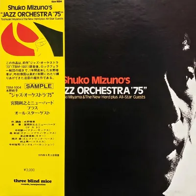

<!-- tbm-liner-cover:start -->

TBM-1004<b>Jazz Orchestra &#x27;75</b><small>Шуко Мізуно, 1975</small><a href="../Альбоми/TBM-1004">Сторінка альбому →</a>

<!-- tbm-liner-cover:end -->

# JAZZ ORCHESTRA '75 (Джазовий оркестр '75)
## Композитор та аранжувальник: Шуко Мізуно (Shuko Mizuno)

---

### СПИСОК КОМПОЗИЦІЙ
1. **JAZZ ORCHESTRA '75 / PART I (Джазовий оркестр '75 / Частина I)** ........................... 14'02"
2. **JAZZ ORCHESTRA '75 / PART II (Джазовий оркестр '75 / Частина II)** .......................... 15'00"
3. **JAZZ ORCHESTRA '75 / PART II (Live Version) (Частина II - Наживо)** ..................... 27'08"

---

### УЧАСНИКИ ТА СТВОРЕННЯ АЛЬБОМУ
* **Солісти:**
  * [[Артист — Сеїчі Накамура|Сеїчі Накамура]] (Seiichi Nakamura) (тенор-саксофон)
  * [[Артист — Кенджі Морі|Кенджі Морі]] (Kenji Mori) (альт- і тенор-саксофон)
  * [[Артист — Кадзумі Ватанабе|Кадзумі Ватанабе]] (Kazumi Watanabe) (гітара)
* **Тосіюкі Міяма (Toshiyuki Miyama)** (лідер та диригент)
* **Трубачі:**
  * [[Артист — Кадзумі Такеда|Кадзумі Такеда]] (Kazumi Takeda)
  * [[Артист — Йошікадзу Кіші|Йошікадзу Кіші]] (Yoshikazu Kishi)
  * Шіро Яманучі (Shiro Yamanuchi)
  * [[Артист — Шігеру Каміморі|Шігеру Каміморі]] (Shigeru Kamimori)
* **Тромбоністи:**
  * [[Артист — Терухіко Катаока|Терухіко Катаока]] (Teruhiko Kataoka)
  * Масамічі Камі (Masamichi Kami)
  * [[Артист — Осаму Шіомура|Осаму Шіомура]] (Osamu Shiomura)
  * Кадзуші Іто (Kazushi Ito)
* **Секція дерев'яних духових (Reeds):**
  * [[Артист — Коджі Судзукі|Коджі Судзукі]] (Koji Suzuki)
  * [[Артист — Мамору Морі|Мамору Морі]] (Mamoru Mori)
  * [[Артист — Ацуо Шіраї|Ацуо Шіраї]] (Atsuo Shirai)
  * [[Артист — Сейджі Іноуе|Сейджі Іноуе]] (Seiji Inoue)
  * Кен'ічі Тада (Kenichi Tada)
* **Піаніст:**
  * [[Артист — Кійоші Такано|Кійоші Такано]] (Kiyoshi Takano)
* **Гітарист:**
  * Козабуро Ямакі (Kozaburo Yamaki)
* **Басисти:**
  * Акіра Оказава (Akira Okazawa) (електричний бас)
  * Мамору Фукушіма (Mamoru Fukushima) (бас)
* **Ударники:**
  * Юта Йомота (Yuta Yomota)
  * Шуїчі «Понта» Муракамі (Shuichi "Ponta" Murakami)
* **Перкусія:**
  * Юдзі Імамура (Yuji Imamura) (конги та перкусія)

* **Запис:** 3 вересня 1975 року, студія Epicurus
* **Наживо (Live):** 26 травня 1976 року, Ginza Yamaha Hall
* **Звукорежисер (Recording Engineer):** Йошіхіко Каннарі (Yoshihiko Kannari)
* **Цифровий мастеринг:** 24 квітня 1988 року
* **Інженер мастерингу (Mastering Engineer):** Йошіхіко Каннарі (Yoshihiko Kannari)
* **Арт-директор:** Бен Нішізава (Ben Nishizawa)

* **Продюсер:** Такесі Фудзії (Takeshi Fujii) (TBM)

---

## 《Рецензія》 
**Шуко Мізуно (Shuko Mizuno)**

Цей твір є у багатьох сенсах «сестринським» до «Jazz Orchestra '73», завершеного рівно два роки тому. Більше того, за ці два роки особисто у мене сталося багато різних подій. Я провів майже рік в Америці, переважно в Нью-Йорку, мандруючи і розмірковуючи про різні речі. Від самого початку я вважав, що можу займатися музикою з дуже вільної позиції, і для мене зовсім не мали значення жанрові чи інші поділи на кшталт «джаз», «рок», «класика» чи «традиційна японська музика». Радше, як композитор, я хотів виконувати роботу, яка б поступово руйнувала такі жанрові межі, знаходячи засоби для вірного самовираження як людини, що живе як японець у сучасному суспільстві. Тим не менш, джаз і рок продовжують утримувати мене своєю потужною силою, і я знову був залучений до створення «Jazz Orchestra '75».

Під час створення «Jazz Orchestra '75» я багато розмірковував про те, чого я не зміг чи не встиг зробити в попередній роботі, а також про те, що я відчув за ці два роки, розробляючи концепцію. Але врешті-решт, у зв'язку з попереднім твором, перша мета полягала в тому, щоб ще більше розширити і просунути лінію загального драйву, зробивши першу половину настільки грандіозним tutti (включаючи соло групи), наскільки це можливо.
Другим новим елементом, якого не було в попередньому творі, було включення елементів року, надання другій половині твору неймовірно хаотичного рок-симфонічного аспекту (mechakucha ni norimakuru rokku shinfonii no yoso), і створення величезної, тривалої кульмінації та екстазу в межах простору LP.
В результаті твір був розділений на дві великі частини: першу і другу, і базовою концепцією стало просування (oshi-tsuseru) через увесь твір без перерви.
І щодо першої половини — це драйв із дещо суворим відчуттям напруги (kibishii kinchokan), а щодо другої половини — це рок, який стає все більш розслабленим і розкутим (relax shite norimakuru rock). Зв'язуючи обидві частини за допомогою спільної теми (мелодії), композиційні завдання поступово визначалися. Елементи першої половини, як я це бачу, беруть свій початок з оригінального твору, випущеного кілька років тому на Teichiku (SL1312) (це був «Kings Roar» [[Артист — Хідето Канаї|Хідето Канаї]]). Я вірю, що вони досягли своєї найвеличнішої форми і реалізації в цьому творі, продовжуючи лінію драйву з першої та другої частин «Jazz Orchestra '73».

Друга половина починається з робочої пісні з важким бітом (heavy beat), яка базується на мелодіях «Yoitomake» та «Enya Kora». Зосередившись на спорідненості між традиційними японськими музичними відчуттями — піснями з соломи (warabe-uta) чи сільськими піснями (народними піснями) — та блюзом, я просував роботу. Загалом вийшов хаос джазу, року та «Yoitomake» (yoyitomake ga konton to natte shimatta no desu), і я вважаю, що ще одна спроба — використання двох барабанщиків (тобто один — джазовий барабанщик, інший — рок-барабанщик) — виявилася цілком успішною. Друга половина Другої частини — це шалено швидкий рок-біт (hageshiku hayai rock beat), і я вважаю, що було б чудово, якби всі були надзвичайно збуджені (excite). Як наслідок, не можна заперечувати, що я був схильний до надмірної любові до пронизливих високих нот труби (tsunzaku koon), реву електрогітари (godon), барабанів, перкусії та грандіозного tutti оркестру.

Запис закінчився лише вчора (3 вересня), і відчуття спеки в студії, яка була наповнена тим гарячковим запалом, ще не охололо, і я все ще в захваті. Я вдячний пану Міямі та музикантам New Herd за те, що вони із задоволенням взялися за цю складну композицію і репетирували її незліченну кількість разів. Також, завдяки великим зусиллям (dai-hassuru) запрошених солістів пана Морі, пана Накамури, пана Ватанабе, а також пана Муракамі, пана Окадзави та пана Імамури, які приєдналися (nori ni notte kurete) до нас учора ввечері, як і очікувалося, цей виступ став можливим.

Нарешті, продюсер пан Такесі Фудзії є батьком цього твору (kono sakuhin no umi no oya). Без нього він, напевно, не був би створений, і я можу впевнено сказати, що у всьому японському музичному світі, не лише в джазі, немає іншого продюсера, який міг би дати мені стільки розуміння і заохочення в музиці (kare hodo ongaku ni norikomi, netsuretsu na rikai to hagemashi o ataete kureru producer wa zettai ni hoka ni inai).
Знайомство з паном Фудзії, безсумнівно, стало найважливішою подією в моєму житті.

**4 вересня 1975 року**

---

**Після завершення виробництва «Jazz Orchestra '75»**
**Такесі Фудзії (Takeshi Fujii)**

Рішення про створення цього «Jazz Orchestra '75» Шуко Мізуно в ознаменування 5-річчя Three Blind Mice Records було прийнято в січні цього року. Ми вирішили відмовитися від усіх вечірок з нагоди 5-річчя і таке інше. Я подумав, що найкращим способом віддячити буде випуск найкращого джазового твору через джаз, і що це відповідає духу записів TBM.
Після запису попередньої роботи (TBM-CD-1801 «Jazz Orchestra '73») Шуко Мізуно поїхав на рік навчатися до Америки на запрошення Фонду Рокфеллера. Я замовив у нього композицію, коли він повернувся восени минулого року. Це було в лютому 75-го року.
Попередня робота отримала переважну підтримку в Нью-Йорку, і всі композиції транслювалися на трьох FM-станціях міста, а одна з них навіть створила двогодинну програму, яка включала інтерв'ю з Шуко Мізуно.
Я вважав, що твір Шуко Мізуно може подолати стіну оркестрового джазу. Це те, що намагалися подолати багато вітчизняних та зарубіжних аранжувальників, індивідуальність Дюка Еллінгтона та свінг Каунта Бейсі. Привабливість оркестрового джазу, тобто: ① потужна атака (intense attack) ансамблю, ② зміни завдяки індивідуальній імпровізації солістів (soloist no koseiteki na ad-lib ni yoru henka), і ③ приголомшливий свінг, який створює весь оркестр (orchestra zentai ga kamoshidasu attooteki na swing) — це те, де виклики повторювалися в кожному аспекті. Експериментальні спроби (jikkenteki na iroai no koi sakuhin) з сильним забарвленням, звичайно, досягли успіху у створенні напруги високої щільності, але експеримент є експериментом (jikken wa jikken de ari), і труднощі перевищення оригіналу завжди залишалися. (Єдине, про що слід було подумати (hansai subeki wa kono ten de atta) у попередній роботі, — це цей момент.)

Після завершення всього монтажу і прослуховування всіх пісень я ще не оговтався від хвилювання (zen-shin wa kofun kara samezu), і звук Шуко Мізуно все ще лунає в моїй голові (atama no naka o kake-megutte iru). Я переконаний, що ми щойно подолали стіну оркестрового джазу в лоб (masshomen kara). Я не знаю жодного іншого оркестрового джазу, який був би настільки сповнений життєвої сили (seimeiryoku ni michi-afure) і так драйвував би. До tutti духової секції та потужного ритму (kyoretsu na beat) секції ритм-енд-блюзу (all-star guest rhythm section), які неможливо описати ніяк інакше, як інтенсивність (kyoretsu) New Herd, додається приголомшлива імпровізація (monosugoi ad-lib) [[Артист — Кенджі Морі|Кенджі Морі]], Сеїчі Накамури та [[Артист — Кадзумі Ватанабе|Кадзумі Ватанабе]] — це і є життєва сила оркестрового джазу.

Цей твір перевершив мої очікування. Перша причина цього полягає в тому, що Шуко Мізуно доклав усіх зусиль для створення цієї композиції. Протягом 5 місяців, починаючи з лютого, він розробляв концепцію, а потім протягом двох місяців з липня, відмовившись від літніх канікул, він працював виключно над партитурою цього твору. Протягом цих 34 днів він працював з 10 ранку до 4 ранку, присвячуючи весь свій час цьому твору, окрім їжі та сну. І протягом інших 20 днів він продовжував писати партитуру майже в такому ж темпі. Результатом стала його найкраща робота на понад 200 сторінках, яку я хочу тут представити.
Друга причина, як я вважаю, полягає в тому, що я зміг зібрати найкращих музикантів, яких тільки можна знайти в сучасному Токіо (Tokyo de kangaerareru saiko no musician o atsumeru koto ga dekita koto ni aru). Під час зустрічей із Шуко Мізуно в процесі композиції (sakkyoku no katei de no uchiawase no ma ni), намагаючись зрозуміти напрямок, у якому він думав, моя робота полягала в тому, щоб залучити найбільш підходящих музикантів для цього, але для цього «Jazz Orchestra '75», я думаю, нам вдалося передати набагато більше людяності самого Мідзуно (Mizuno-yoshi honrai no ningen-kusa-sa to ioka), тобто його безтурботний (yoki de), оптимістичний (rakutenteki de) і водночас конструктивний (kensetsuteki na) та великодушний характер (ookarana kosei), ніж у його попередній роботі. Тому я хочу від щирого серця подякувати всім гостям-солістам та музикантам ритм-секції, яких ми обрали, а також всім учасникам New Herd, які блискуче виправдали ці очікування.

Насамкінець я хотів би процитувати слова композитора і звернутися до всіх, хто слухатиме цей твір.
«Моя музика не має особливого сенсу, якщо її не слухати на максимальній гучності (dekiru dake volume o ippai ni agete dai-onryo de kikanakute wa amari imi ga nai to iu koto desu). Я хочу, щоб ви слухали її якомога голосніше (naru-beku okina oto de gaan to yatte moraitai no desu). Було б неприємно, якби ви слухали її тихо (moshi chiisana oto de kasakoso to nattara komaru no desu). Тому що тиск гучності є важливою життєвою силою (volume no atsuryoku ga juyo na seimeiryoku da kara desu). Тому я хочу, щоб ви слухали її, коли у вас є фізичні та духовні сили (tairyoku to kiryoku no aru toki ni), щоб витримати гучний звук протягом тривалого часу (chojikan okina oto ni taerareru).»
*(1975)*
