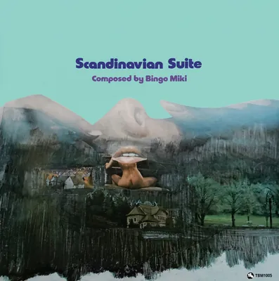

<!-- tbm-liner-cover:start -->

TBM-1005<b>Scandinavian Suite</b><small>Бінго Мікі, Тацуя Такахаші та Tokyo Union, 1977</small><a href="../Альбоми/TBM-1005">Сторінка альбому →</a>

<!-- tbm-liner-cover:end -->

# “北欧組曲” / “SCANDINAVIAN SUITE” (“Скандинавська сюїта”)

**Композитор та аранжувальник:** [[Артист — Бінго Мікі|Бінго Мікі]] (Bingo Miki)  
**Виконавці:** [[Артист — Тацуя Такахаші|Тацуя Такахаші]] та The Tokyo Union (Tatsuya Takahashi & The Tokyo Union)  
**Каталожний номер:** TBM(P)-1005  
**Лейбл:** three blind mice records, incorporation

---

## СПИСОК КОМПОЗИЦІЙ

### 〈SIDE A〉
1. **パート I 白夜の哀しみ / Part I Midnight Sunrise** (Смуток білої ночі) — 7:10
2. **パート II エドワード・ムンクの肖像 / Part II Sketches Of Munch** (Портрет Едварда Мунка) — 7:20
3. **パート III グレタ・ガルボの伝説 / Part III The Legend Of Garbo** (Легенда про Грету Гарбо) — 6:33

### 〈SIDE B〉
1. **パート IV アンデルセンの幻想 / Part IV Andersen Fantasia** (Фантазія Андерсена) — 7:20
2. **パート V シベリウスの遺言 / Part V Sibelius' Testament** (Заповіт Сібеліуса) — 5:10
3. **パート VI 遊ぶ子供たち / Part VI Children At Play** (Діти, що граються) — 6:24

---

## СКЛАД ВИКОНАВЦІВ (Тацуя Такахаші та The Tokyo Union)

* **Труби:** [[Артист — Йошіфумі Тада|Йошіфумі Тада]] (Yoshifumi Tada), [[Артист — Хіроші Абіко|Хіроші Абіко]] (Hiroshi Abiko), [[Артист — Мотохару Судзукі|Мотохару Судзукі]] (Motoharu Suzuki), Томокадзу Саїо (Tomokazu Saio)
* **Тромбони:** Ейдзіро Міядзакі (Eijiro Miyazaki), [[Артист — Кійотака Учіда|Кійотака Учіда]] (Kiyotaka Uchida), Коїчі Окада (Koichi Okada)
* **Бас-тромбон:** Кен'їчі Сударе (Ken-ichi Sudare)
* **Альт-саксофони:** Кейдзі Хорі (Keiji Hori), [[Артист — Хіроші Ягінума|Хіроші Ягінума]] (Hiroshi Yaginuma)
* **Тенор-саксофон:** Сейдзі Іноуе (Seiji Inoue)
* **Баритон-саксофон:** [[Артист — Такемі Ішікане|Такемі Ішікане]] (Takemi Ishikane)
* **Фортепіано:** [[Артист — Масахіро Канаяма|Масахіро Канаяма]] (Masahiro Kanayama)
* **Бас:** Рьосуке Ішіда (Ryosuke Ishida)
* **Ударні:** Казухіро Ебісава (Kazuhiro Ebisawa)
* **Гітари:** Кен'їчі Арая (Ken-ichi Araya), [[Артист — Такао Наої|Такао Наої]] (Takao Naoi)
* **Запрошені гості:**
  * Юдзі Імамура (Yuji Imamura) — перкусія
  * [[Артист — Міккі Йошіно|Міккі Йошіно]] (Mickie Yoshino) — синтезатор
* **Лідер та тенор-саксофон:** [[Артист — Тацуя Такахаші|Тацуя Такахаші]] (Tatsuya Takahashi)

---

## КОМАНДА ПРОЄКТУ

* **Продюсер:** Такесі Фудзії (Takeshi Fujii)
* **Звукорежисер запису:** Йошіхіко Каннарі (Yoshihiko Kannari) [Epicurus]
* **Інженер нарізки (каттингу):** Тору Котецу (Toru Kotetsu) [Victor Japan]
* **Артдиректор:** Бен (Цутому) Нішідзава (Ben Nishizawa)
* **Коментарі (анотації):** Шоїчі Юї (Shoichi Yui), Норійоші Кояма (Noriyoshi Koyama)
* **Сприяння:** Кадзуміцу Сага (Kazumitsu Saga), Акінорі Фукутомі (Akinori Fukutomi)

**Дата запису:** 15 та 22 травня 1977 року  
**Місце запису:** Студія Epicurus, Токіо

---

## Коментар 1
**Шоїчі Юї (Shoichi Yui)**

Я вважаю, що це шедевр, гідний дебютної роботи довгоочікуваного масштабного новачка!!

Я переслуховував «Скандинавську сюїту» знову і знову, і вона вже повністю засіла в моїй голові. Вона страшенно сподобалася мені ще тоді, коли я вперше почув її на магнітній стрічці, тож коли до моїх рук потрапила сама вінілова платівка, перед тим як опустити на неї голку, я ретельно наніс на поверхню захисний засіб для дисків. Секрет цього засобу полягає в тому, що він утворює на поверхні платівки ще одну надтонку плівку, завдяки чому диск зовсім не зношується, скільки б разів ви його не програвали.

Рівень нарізки (каттингу) дещо стриманий, проте якщо увімкнути на повну гучність, звучання просто неймовірне. Як і очікувалося від запису Йошіхіко Каннарі — звук вражає. Оскільки особливістю моєї апаратури є насичені верхи та низи, коли я прибрав регулятори високих і низьких частот на $3\text{ dB}$ кожен, то отримав ідеально рівний звук в усіх діапазонах. Рідко трапляються платівки, де програмне джерело охоплює настільки широкий частотний діапазон. До того ж тут абсолютно немає шипіння стрічки чи інших сторонніх шумів. Звук такий, ніби його писали методом прямого нарізання (direct cutting). Не так вже й часто можна зустріти платівку, де за допомогою регуляторів тембру можна настільки точно підібрати оптимальне для власного вуха звучання.

І справа не лише в чудовому звуці — саме виконання прекрасне. [[Артист — Тацуя Такахаші|Тацуя Такахаші]] та The Tokyo Union впоралися на відмінно. За останні кілька років якісне зростання Tokyo Union просто вражає, але навіть на цьому тлі «Скандинавську сюїту» можна зарахувати до найбільш знакових та видатних виступів цього оркестру. Здається, композитор [[Артист — Бінго Мікі|Бінго Мікі]] вільно й невимушено замальовує свої враження від Північної Європи, але насправді він, безсумнівно, писав партитуру, тримаючи в голові образ кожного окремого учасника Tokyo Union і думаючи: «А ось тут я таким-то чином подам тенор нашого метра Такахаші». Адже він сам близько року активно працював у цьому оркестрі як аранжувальник і тенор-саксофоніст. Коли твір виконує оркестр, який ти знаєш до найменших дрібниць, це завжди дає величезну перевагу. У записі також узяли участь кілька запрошених гостей, які подекуди навіть допомагають розкрити прихований потенціал Tokyo Union.

«Якщо любиш дитя — відправ його в подорож» — каже давнє японське прислів'я. І батьки, які відпустили Бінго за кордон на цілих п'ять з половиною років, гідні захоплення, і син, який виправдав їхні сподівання, — молодець. [[Артист — Бінго Мікі|Бінго Мікі]] закінчив Міжнародний християнський університет (ICU), а ви добре знаєте, що це далеко не той заклад, куди може вступити кожен охочий. Тим більше, що на курс молодше від нього навчалося покоління безпрецедентного повоєнного бебі-буму, яке буквально наступало на п'яти.

З-поміж п'яти з половиною років його життя за кордоном мою увагу особливо привернув той факт, що близько року він брав приватні уроки у Джорджа Расселла. Джордж Расселл — це композитор, за яким я зараз стежу з найбільшим інтересом. Він є видатним джазовим теоретиком і музикантом, який продовжував створювати модальні твори задовго до того, як модальний джаз став відомим завдяки Майлзу чи Колтрейну. Восени 1970 року, коли я сам обідав у готелі в Берліні, до мене раптом підійшов чоловік, представився: «Я — Джордж Расселл» і попросив дозволу сісти за мій столик. Я був приголомшений тим, що цей великий композитор звернувся до мене. Навколо були вільні місця, тож я одразу зрозумів, що він хотів поговорити саме зі мною. У той час він обмірковував створення власного приватного лейблу і шукав підходи до того, з якою японською звукозаписною компанією йому варто було б налагодити співпрацю. «Кілька років тому серед музикантів було модно мати власне музичне видавництво. А зараз черга дійшла до власних рекорд-компаній», — сказав він тоді.

Я слухав усі твори Джорджа Расселла, які виходили на платівках. Найбільше мені подобається «All About Rosie», виконана наживо в Університеті Брандейса, але наша розмова перейшла від «New York, N.Y.» на лейблі Decca до серії його шедеврів на Riverside. Ми з Расселлом швидко потоваришували, а наступного дня разом дивилися через Берлінський мур на Бранденбурзькі ворота та оглядали КПП «Чарлі» (Checkpoint Charlie). Твором, світова прем'єра якого відбулася тоді в Берліні, була його «Electronic Sonata for Souls Loved by Nature».

Частинки знань, які [[Артист — Бінго Мікі|Бінго Мікі]] перейняв від Джорджа Расселла, очевидні й у цій роботі. Тема, що проходить крізь кожну частину «Скандинавської сюїти», написана в дорійському ладу, а у «Фантазії Андерсена» ефективно використовуються дорійський та лідійський лади, причому розміри $\frac{3}{4}$ та $\frac{4}{4}$ почергово змінюють один одного.

В англомовних анотаціях до платівки я написав: «Для нашого японського слуху ця сюїта звучить так, ніби вона щиро й вичерпно змальовує спостереження та благоговіння японця перед похмурим скандинавським небом, сонцем, що ніколи не сідає, та багатою на традиції культурою. Але мені дуже цікаво дізнатися, як сприймуть цей твір і це виконання, створені японцями, люди, які насправді там народилися і виросли». Та насправді я хочу якомога швидше почути, що скажуть не лише жителі Північної Європи, а й наставник [[Артист — Бінго Мікі|Бінго Мікі]] — Джордж Расселл, коли послухає цю роботу. Сам Джордж Расселл знає скандинавські краєвиди та звичаї вздовж і впоперек. Мабуть, учитель не стане просто засипати учня компліментами. Він напевно дасть йому корисні поради суто технічного плану. Але найбільше мені кортить дізнатися, як він сприйме скандинавські пейзажні замальовки, пропущені крізь японське світовідчуття.

Які ще твори напише у майбутньому [[Артист — Бінго Мікі|Бінго Мікі]] — який ще під час своєї роботи тенор-саксофоністом у Tokyo Union створював унікальні композиції — взявши за відправну точку цю чудову «Скандинавську сюїту»?

Я вважаю, що це шедевр, гідний дебютної роботи довгоочікуваного масштабного новачка!!

---

## Коментар 2: Віха в історії оркестрового джазу
**Норійоші Кояма (Noriyoshi Koyama)**

Це було у вересні 1970 року, коли лейбл Three Blind Mice заявив про себе як про спеціалізований лейбл японського джазу під девізом створення і популяризації оригінального «японського джазу» та відкриття нових талантів, випустивши свої перші дві платівки — «Mine» [[Артист — Косуке Міне|Косуке Міне]] та «Now» Масару Імади. Відтоді, попри численні труднощі, завдяки своїй пристрасті, наполегливій праці та підтримці оточуючих, TBM цього року урочисто відсвяткував свою 7-му річницю.

За цей час TBM сприймав кожен непарний рік як певний рубіж: на 3-тю річницю в 1973 році вони поклали початок серії альбомом «Jazz Orchestra '73», на 5-ту річницю записали пам'ятний «Jazz Orchestra '75», втіливши в них свої високі амбіції, а в нинішньому (1977) році, що знаменує 7-му річницю, як ювілейний реліз було створено цей альбом — «Скандинавську сюїту».

За словами продюсера Такесі Фудзії, творця «Скандинавської сюїти», вона була завершена завдяки такій послідовності подій. Обидва альбоми — «Jazz Orchestra '73» та «Jazz Orchestra '75» — створювалися у форматі, де написання музики замовляли гостросучасному композитору [[Артист — Шуко Мізуно|Шуко Мізуно]], а виклик виконати її брав на себе розширений оркестр на базі Toshiyuki Miyama & The New Herd. Ювілейний альбом до 7-ї річниці, «Скандинавська сюїта», у цьому сенсі є таким самим оркестровим джазом, як і дві попередні роботи, проте і композитор, і виконавці тут зовсім інші: музику написав [[Артист — Бінго Мікі|Бінго Мікі]], а за виконання відповідав розширений оркестр, сформований навколо Тацуї Такахаші та The Tokyo Union. Поштовхом до того, що продюсер Фудзії цього разу залучив найсвіжіший талант у світі вітчизняної композиції та аранжування — [[Артист — Бінго Мікі|Бінго Мікі]], стало глибоке враження, яке він отримав у листопаді минулого 1976 року на ювілейному концерті до 10-річчя Tokyo Union у залі Yubin Chokin Hall (Шіба, Токіо), де оркестр уперше виконав твір [[Артист — Бінго Мікі|Бінго Мікі]] «Смуток білої ночі» (Midnight Sunrise). Саме в той момент було вирішено, що концепція ювілейної платівки до 7-річчя TBM базуватиметься на творі [[Артист — Бінго Мікі|Бінго Мікі]] у виконанні Tokyo Union.

[[Артист — Бінго Мікі|Бінго Мікі]] (його біографію див. в окремому додатку), який лише у березні 1976 року приєднався до Tokyo Union як композитор, аранжувальник і тенор-саксофоніст, на той час був ще майже нікому не відомим. Проте продюсер Фудзії розгледів його талант і прийняв сміливе рішення звернутися до нього із замовленням: «Я хочу, щоб до травня 1977 року ви написали повноцінну сюїту». У відповідь на це прохання і була створена «Скандинавська сюїта», що складається з 6 частин. Усі композиції цієї «Скандинавської сюїти» згодом уперше прозвучали наживо в перший день фестивалю «5 Days In Jazz '77» (12 травня 1977 року в залі Shinjuku Kosei Nenkin Hall, Токіо), де, як і очікувалося, викликали шквал захоплених відгуків і мали величезний успіх. Після цього, 15 та 22 травня, матеріал ще раз відіграли та записали в студії, завершивши роботу над цим альбомом — «Скандинавською сюїтою».

«Скандинавська сюїта» складається з 6 частин: 〈Смуток білої ночі〉, 〈Портрет Едварда Мунка〉, 〈Легенда про Грету Гарбо〉, 〈Фантазія Андерсена〉, 〈Заповіт Сібеліуса〉 та 〈Діти, що граються〉. Композитор [[Артист — Бінго Мікі|Бінго Мікі]] під час навчання у Музичному коледжі Берклі в США (1972–1975 рр.) водночас брав уроки композиції та аранжування у видатного метра Джорджа Расселла. Але ще перед тим, з червня 1971 по квітень 1972 року, він жив у Північній Європі: мешкав у гірській хатині неподалік Гельсінкі, проводячи дні у невпинних заняттях на тенор-саксофоні. І п'єса «Смуток білої ночі», яка стала відправною точкою «Скандинавської сюїти», і вся завершена згодом сюїта, як свідчить сама назва, є музичним втіленням образів Північної Європи, що закарбувалися в серці самого композитора. Нижче я коротко торкнуся кожної окремої композиції та її виконання.

**〈白夜の哀しみ / Смуток білої ночі〉** — Коли говорять про Північну Європу, одразу згадують білі ночі. Свого часу Квінсі Джонс блискуче змалював романтичну атмосферу білих ночей у знаменитій п'єсі «The Midnight Sun Will Never Set». Твір Мікі за допомогою щемливої меланхолійної мелодії та майстерної обробки синтезатора поетично зображує білу ніч перед світанком. Сольні партії виконують [[Артист — Хіроші Ягінума|Хіроші Ягінума]] на альт-саксофоні та [[Артист — Хіроші Абіко|Хіроші Абіко]] на флюгельгорні.

**〈エドワード・ムンクの肖像 / Портрет Едварда Мунка〉** — Мунк — великий художник, народжений Норвегією. Мунк малював землю, малював робітників і невпинно оспівував кохання. У цьому Мікі відчув фанковий блюз. Після того як Томокадзу Саїо на флюгельгорні виконує вступну мелодію, композиція переходить у блюзову гру в розмірі $\frac{5}{4}$. Цікаво, що в бріджі вставлено вільний епізод (free part) у дусі французького імпресіонізму, який вносить у п'єсу різноманітність. Тут яскраво проявляють себе [[Артист — Міккі Йошіно|Міккі Йошіно]] на синтезаторі, [[Артист — Такао Наої|Такао Наої]] на гітарі, Сейдзі Іноуе на тенор-саксофоні та [[Артист — Масахіро Канаяма|Масахіро Канаяма]] на фортепіано. В ансамблевому проведенні теми секцією труб із сухим звучанням відчувається вплив методів Джорджа Расселла.

**〈グレタ・ガルボの伝説 / Легенда про Грету Гарбо〉** *(у тексті буклета помилково названо «Портрет Грети Гарбо»)* — Гарбо — видатна акторка, народжена у Стокгольмі, яку за її таємничу красу називали королевою срібного екрана. Ця п'єса — пісня про кохання, що оспівує прекрасну скандинавську жінку. Серед усієї «Скандинавської сюїти», побудованої на модальних прийомах, лише ця композиція написана на основі стандартної акордової послідовності. Лідер оркестру [[Артист — Тацуя Такахаші|Тацуя Такахаші]] розгортає тут емоційне соло на тенор-саксофоні.

**〈アンデルセンの幻想 / Фантазія Андерсена〉** — Андерсен — автор казок, народжений Данією. Це світ ліричних почуттів та фантастичних казок (Märchen). Мікі розповідає, що він задіяв різноманітні інструменти і спробував досягти тонких змін у кожній сфері — у тембрових барвах, темпі, гармонії та структурі. [[Артист — Масахіро Канаяма|Масахіро Канаяма]] грає романтичне фортепіанне соло, далі виконання у ритмі вальсу поступово набирає драйву, і з'являється надзвичайно співуче соло [[Артист — Хіроші Абіко|Хіроші Абіко]] на флюгельгорні.

**〈シベリウスの遺言 / Заповіт Сібеліуса〉** — Ян Сібеліус — великий композитор, народжений Фінляндією. Важке, величне й урочисте звучання симфонічної поеми Сібеліуса «Фінляндія», за словами Мікі, є невід'ємною частиною Скандинавії та змушує уявити замкнений світ снігів. Вступна частина цієї симфонічної поеми використана на початку композиції. Після аранжованої частини виконання різко змінюється, переходячи у швидке фортепіанне соло. Глибокий сніг. Блискучі кристали льоду. Соло Хіроші Ягінуми на альт-саксофоні. Рух ударних. І нарешті сольний виступ Кейдзі Хорі на кларнеті сповіщає про прихід весни.

**〈遊ぶ子供たち / Діти, що граються〉** — Світ дітей всюди однаковий. Вони збираються разом і безтурботно галасують. Починаючи зі звуків конґи, учасники оркестру невимушено перегукуються на своїх інструментах, аж поки музика не переходить у головну тему сюїти, що була представлена на початку в 〈Смутку білої ночі〉. Соло на тромбоні виконує Ейдзіро Міядзакі. У другій половині п'єси музиканти видобувають обертони, граючи лише на голівках флейт, а мідні духові «співають» крізь самі лише мундштуки — виконання завершується на піку веселої та радісної атмосфери.

Коли дослухаєш «Скандинавську сюїту» до кінця, найсильніше відчуваєш прекрасну мелодію, що тече крізь неї, гуманізм і романтизм. Це партитура молодості композитора [[Артист — Бінго Мікі|Бінго Мікі]] й водночас пам'ятна віха в історії оркестрового джазу, створеного японцями. Разом із тим ця робота стала одним із блискучих досягнень для Тацуї Такахаші та The Tokyo Union, які останніми роками демонструють разючий прогрес. Слухачі, які візьмуть цей альбом до рук, напевно будуть вражені чудовою сольною грою лідера Такахаші на тенор-саксофоні, а також таких учасників, як Абіко, Ягінума та Канаяма. У будь-якому разі, я хочу ще раз висловити своє захоплення оркестру Tokyo Union, який, отримавши такий прекрасний матеріал, разом із запрошеними гостями на повну продемонстрував свою майстерність і зробив цей альбом по-справжньому епохальним.

Крім того, варто додати, що Tokyo Union вже випустили на лейблі TBM два альбоми — «Got The Spirit» та «Maiden Voyage», тож «Скандинавська сюїта» є їхньою третьою роботою, і цього разу платівка виходить у продаж одночасно в Японії та Швеції.

---

## ДАНІ ПРО ЗАПИС (RECORDING DATA)

* **Мікшерний пульт:** API Model 2824 (AUTOMATED PROCESSES, Inc.)
* **Моніторні акустичні системи:** Model 4341 (JBL)
* **Підсилювач моніторів:** MC-2300 (McINTOSH)
* **Майстер-магнітофон:** A-80 16ch 76cm/sec. (STUDER)
* **Двоканальний магнітофон:** A-80 2ch 38cm/sec. (STUDER)
* **Магнітна стрічка:** 250 (SCOTCH)
* **Мікрофони:**
  * **Труби:** RE-20 (ELECTRO-VOICE) $\times 2$
  * **Тромбони:** U-87 (NEUMANN) $\times 2$
  * **Саксофони:** U-67 (NEUMANN) $\times 5$
  * **Кларнет:** Line (Лінійний вхід)
  * **Фортепіано:** C-451 (AKG) $\times 2$
  * **Електропіаніно:** Line
  * **Електрогітари:** RE-16 (ELECTRO-VOICE)
  * **Електричний бас:** Line
  * **Ударні:**
    * Бас-бочка (Kick): MD-421 (SENNHEISER)
    * Соло (Solo), Бас-том (B.T), Альт-томи (T.T, T.T), Малий барабан (S.N): U-67 (NEUMANN)
    * Оверхед (Top): U-87
  * **Латинська перкусія:** RE-20
  * **Синтезатори:** Line
