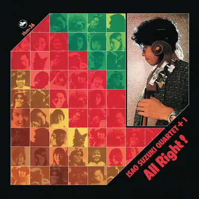

<!-- tbm-liner-cover:start -->

TBM-36<b>All Right!</b><small>Квартет Ісао Судзукі + 1, 1974</small><a href="../Альбоми/TBM-36">Сторінка альбому →</a>

<!-- tbm-liner-cover:end -->

# ALL RIGHT!
## ISAO SUZUKI (ІСАО СУДЗУКІ)

---

## 《Нотатки з вкладиша》
**Осаму Учіда**

Мушу зізнатися, що мене вразила абсолютна універсальність «Ома-сана» ([[Артист — Ісао Судзукі|Ісао Судзукі]]).

Дозвольте мені почати з розповіді про численні таланти та досягнення [[Артист — Ісао Судзукі|Ісао Судзукі]]. Шанувальники джазу в Токіо, безсумнівно, знають, що протягом багатьох років «Ома-сан» очолював постійний гурт (house group) у *Five Spot* в Джіюгаока, клубі, яким керував критик Шьоїчі Юї. Не можу сказати, що сам був там завсідником, але щоразу, коли я бачив його, він грав на різних інструментах на додаток до баса. Навіть тоді він був відомий, якщо використати дещо модний вислів, як «мультиінструменталіст».

Саме тому, наприклад, його ім'я часто з'являлося в таких категоріях, як вібрафон і вокал, в опитуваннях читачів *Swing Journal*. Очевидно, постійні відвідувачі клубу були достатньо вражені, щоб голосувати за нього. Шанувальники джазу за межами Токіо, однак, мали менше можливостей побачити цей його бік. Навіть якщо вони знали «Ома-сана» як басиста, вони рідко мали нагоду побачити, як він майстерно володіє іншими інструментами. Тому, хоча він багато гастролював Японією з Мелом Волдроном (Mal Waldron), більшість людей, мабуть, зберегли лише його образ як басиста.

Навіть я сам не повною мірою цінував масштаб його здібностей поза басом до порівняно недавнього часу. Дивлячись на це ширше, розумієш, що багато японських джазових музикантів насправді віртуозно володіють напрочуд різноманітними інструментами.

У випадку Судзукі бас, безперечно, є його основним інструментом, але це зовсім не означає, що інші — це лише хобі або побічні захоплення. Він підходить до кожного з абсолютною серйозністю.

Візьмемо, наприклад, віолончель. Природно, що на початку його інтонація була настільки грубою, що слухати було важко. Записи часів його виступів у *Ginpari* це яскраво демонструють. Проте завдяки невпинним зусиллям він згодом розвинувся у джазового віолончеліста світового рівня. Робота на віолончелі в альбомі *Blow Up* була справді разючою. Те саме можна сказати і про інші інструменти, на яких він грає на цьому альбомі.

Я вже писав в іншому місці про його блюзове фортепіано. Минулого літа Ома-сан зліг із гострим перитонітом, і я випадково став його хірургом. Протягом того місяця чи близько того, що він провів у моїй лікарні, піаніст «Пу-сан» ([[Артист — Масабумі Кікучі|Масабумі Кікучі]]) також перебував там. Ці двоє здавалися водночас і сумісними, і несумісними, і спостерігати за ними разом протягом такого тривалого часу було надзвичайно цікаво.

Одного разу великий блюзовий піаніст [[Артист — Масабумі Кікучі|Масабумі Кікучі]] виглядав незвично серйозним і задумливо зауважив:
«Цей хлопець Омасудзу — дивний персонаж, але в музичному плані в ньому є щось настільки хороше, що це майже дратує мене. Ви ж самі знаєте, лікарю. Його блюзове фортепіано — це справжня річ. Можливо, найкраще в Японії. Я заздрю...»

Це могло бути дещо надмірною похвалою з вуст Пу-сана, але, можливо, в цьому була і частка справжньої правди. Зрештою, музиканти того покоління мали схильність визнавати один одного приватно, але рідко висловлювали своє захоплення відкрито.

Як примітка: невдовзі після виписки Судзукі з лікарні Кікучі зголосився зіграти на концерті Isao Suzuki Group в Нагої і видав неймовірне блюзове виконання, яке звучало майже так, ніби він кидав прямий виклик Судзукі. Можливо, ці двоє дійсно були більш сумісними, ніж здавалося.

Насамкінець дозвольте мені завершити кількома спостереженнями про музику.

Соло на органі Hammond у виконанні Ома-сана на 3-му треку Сторони А — це ідеальний приклад його в найкращій формі. В Японії є чудовий, хоча й дещо недооцінений, органіст на ім'я [[Артист — Ушіо Сакаї|Ушіо Сакаї]]. Його блюзова гра першокласна, але виконання Ома-сана тут витримує порівняння із Сакаї в його найкращі моменти.

Мене також глибоко вразив прогрес, який продемонстрував [[Артист — Кадзумі Ватанабе|Кадзумі Ватанабе]] (Kazumi Watanabe) на цьому записі. Був момент, коли я хвилювався, що його незвичайна технічна легкість може звести його на манівці, але він фундаментально занадто серйозний і дисциплінований музикант для цього. Здається, він уважно дивиться на себе і продовжує розвиватися. Я чую, що незабаром він може приєднатися до великого гурту. Спочатку він привернув значну увагу в репетиційному бенді Садао Ватанабе. Це виглядає майже так, ніби після того, як його виховав [[Артист — Ісао Судзукі|Ісао Судзукі]], він повертається до свого коріння. Я з нетерпінням чекаю побачити, як він зробить ще більший стрибок уперед.

Електричний басист Акіра Оказава (Akira Okazawa) — ще один видатний талант. Я пам'ятаю, коли він був учасником гурту Дзіро Інагакі; Інагакі говорив про нього з величезною гордістю та великими очікуваннями на майбутнє. На нещодавньому концерті Ватанабе я на власні очі (і вуха) оцінив його гру і пішов звідти переконаним, що йому судилося стати великою фігурою. Якщо він серйозно займеться джазовим басом, а не лише рок-орієнтованими стилями, які він грав досі, він безсумнівно утвердиться серед провідних музикантів. Я з нетерпінням чекаю його майбутніх досягнень.

Щодо акустичного басиста Кавакамі (Kawakami), мушу визнати, що я ще не знаю його достатньо добре, щоб коментувати об'єктивно, тому утримаюся від цього.

Барабанщик [[Артист — Шінджі Морі|Шінджі Морі]] (Shinji Mori) володіє винятково природним відчуттям свінгу і є, безперечно, музикантом з величезним потенціалом. Його особистість є не менш привабливою, і я щиро сподіваюся, що він продовжуватиме рости і досягати успіху.

Остання частина цих нотаток, можливо, стала дещо неорганізованою, і я відчуваю за це певну провину. Тим не менш, цей альбом — чудовий запис. Вкорінене глибоко в джазовій традиції, але сповнене щирості та відданості, його виконання глибоко зворушує. Піднімемо тост за досягнення нашого Ома-сана. Будьмо!

---

## 《Про запис TBM-36》
**Масайоші Окава**

У цьому записі широко використовувалося накладення (багатоканальний запис), тому я хотів би пояснити цей процес на прикладі композиції *Time After Time*.

Хоча готовий трек навряд чи звучить як робота лише двох музикантів, насправді це дуетне виконання [[Артист — Кадзумі Ватанабе|Кадзумі Ватанабе]] та [[Артист — Ісао Судзукі|Ісао Судзукі]]. Спочатку ми записали акустичну гітару та контрабас, а все інше було додано пізніше за допомогою накладення (overdubbing).

Спершу був записаний основний ритм-трек. Потім його перевели в систему Sel-Sync (функція, яка компенсує часову затримку між головками запису та відтворення шляхом перемикання записуючої головки для роботи як відтворювальної; ця функція доступна на кожному каналі). Трек подавався в навушники, і, слухаючи його, Судзукі наклав барабани та віолончель у два окремі проходи.

Далі ці щойно записані партії самі були переведені в режим Sel-Sync, зведені до правильного моніторного балансу і надіслані в навушники Ватанабе, щоб він міг додати додаткові гітарні партії. Нарешті були накладені вокальні та скет-треки. Загалом для цього твору знадобилося п'ять проходів накладення.

Цей метод, звичайно, вимагає більше часу для завершення одного треку, але він має кілька переваг. Якщо допущено помилки, партії можна перезаписувати стільки разів, скільки потрібно, і практично немає витоку звуку між доріжками. Кожна композиція на цьому альбомі була записана за цією процедурою.

Я пропущу детальні схеми розстановки мікрофонів для кожного інструмента, але для віолончелі ми знову використали конденсаторний мікрофон Neumann ECM-50, закріплений безпосередньо на підставці (bridge), так само, як ми робили на *Blow Up*. Можливо, через процес накладення інструмент набув характерного, солодкого тону. Такий самий мікрофон був встановлений під підставкою контрабаса.

Для вібрафона ми розмістили два мікрофони, спрямовані на високий і низький регістри, приблизно на метр над інструментом. Ви можете помітити, що звук відрізняється від тону вібрафона, до якого ви звикли. Це частково пов'язано з модифікаціями, які Судзукі зробив зі своїми паличками (mallets).

Раніше електричне піаніно записувалося безпосередньо через лінійний вхід, але оскільки такий підхід, як правило, давав дещо тонкий звук, цього разу ми використали мікрофони, щоб досягти повнішого, багатшого тону. Загалом, саме так був записаний альбом. Майстер-стрічка рухалася зі швидкістю 76 см за секунду, що дозволило нам максимізувати як співвідношення сигнал/шум, так і динамічний діапазон.

Нарешті, як особисте зауваження, я хотів би згадати, що Немуро (Nemuro), яке з'являється в першому треку Сторони А, — це моє рідне місто. Я глибоко вдячний усім членам Nemuro Hot Jazz Club, чий ентузіазм і підтримка допомогли втілити цей проект у життя.

Для всіх нас, залучених у виробництво, включно з продюсером Фудзії та рештою персоналу, є великим джерелом задоволення знати, що таких пристрасних шанувальників джазу можна знайти в регіональних спільнотах по всій Японії.
