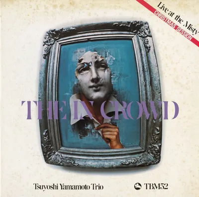

<!-- tbm-liner-cover:start -->

TBM-52<b>The In Crowd</b><small>Тріо Цуйоші Ямамото, 1974</small><a href="../Альбоми/TBM-52">Сторінка альбому →</a>

<!-- tbm-liner-cover:end -->

# THE IN CROWD (У колі обраних)
## Live at the Misty
## Тріо Цуйоші Ямамото (Tsuyoshi Yamamoto Trio)

**Three Blind Mice Records:** [[TBM-52]] / THCD-317 (DQCP-5265)

### СПИСОК КОМПОЗИЦІЙ

**Сторона A**
1. **Blues in the Basement** (Ray Brown) ........................................ 10'57"
2. **For Once in My Life** (Orlando Murden – Ronald Miller) ........................ 6'15"
3. **You Are My Sunshine** (Jimmy Davis – Charles Mitchell) ........................ 7'05"

**Сторона B**
1. **The In Crowd** (Ramsey Lewis) ............................................... 13'25"
2. **I Can't Get Started** (Vernon Duke – Ira Gershwin) ............................ 5'40"

---

### УЧАСНИКИ ЗАПИСУ

* **[[Артист — Цуйоші Ямамото|Цуйоші Ямамото]] (Tsuyoshi Yamamoto)** (фортепіано)
* **Акіра Ою (Akira Daiyoshi)** (бас)
* **[[Артист — Тошіо Осумі|Тошіо Осумі]] (Toshio Osumi)** (ударні)

---

* **Запис:** 25 грудня 1974 року, клуб Misty, Роппонгі, Токіо
* **Продюсер:** Такесі Фудзії (Takeshi Fujii) для Three Blind Mice Records, Inc.
* **Звукорежисер (Recording Engineer):** Йошіхіко Каннарі (Yoshihiko Kannari) (Aoi)
* **Асистент звукорежисера:** Масайоші Окава (Masayoshi Okawa) (Aoi)
* **Інженер нарізки (Cutting Engineer):** Макото Накамура (Makoto Nakamura) (Toshiba-EMI)
* **Арт-директор:** Бен Нішізава (Ben Nishizawa)
* **Автор анотації:** Хідекі Сато (Hideki Sato)
* **Співпраця:** Кадзуміцу Сага (Kazumitsu Saga), Акінорі Фукутомі (Akinori Fukutomi)

### ПЕРЕВИДАННЯ

* **Оригінальний запис:** Three Blind Mice ([[TBM-52]])
* **Промоутер-директор:** Рьоко Сакамото (Ryoko Sakamoto) (THINK! RECORDS)
* **Науковий нагляд:** Кокі Ханава (Koki Hanawa)
* **Особлива подяка:** Юсуке Оґава (Yusuke Ogawa), Кодзо Ватанабе (Kozo Watanabe)
* **Видавець:** Sony Music Direct (Japan) Inc.
* **Формат:** Blu-spec CD, стерео
* **Примітка:** тривалість і написання назв подано за оригінальною платівкою.

℗ 1975 Sony Music Direct (Japan) Inc.

---

## 《Анотації》
**Хідекі Сато (Hideki Sato)**

Піаніст [[Артист — Цуйоші Ямамото|Цуйоші Ямамото]], який несподівано з'явився перед нами з альбомом «Midnight Sugar», відтоді записав ще кілька платівок і, схоже, міцно полонив серця шанувальників джазу. Він належить до музикантів чисто свінгового типу, яких досі недооцінювали на японській джазовій сцені. Приємна й красива виразність, народжена його чудовим туше, дарує слухачеві найрозкутішу радість із тих, які може дати музика. Звісно, у цьому стилі грає багато музикантів, крім Ямамото, і в різних напрямах з'явилися видатні таланти. Проте мало хто здатен так природно сідати за фортепіано й видобувати з нього таку невичерпну співучість.

Про Ямамото як людину й музиканта його давній друг і партнер, барабанщик [[Артист — Тецуджіро Обара|Тецуджіро Обара]], говорить так: «Ми товаришуємо ще зі студентських років, і він неперевершено вміє розуміти почуття інших людей. До того ж як піаніст він має чудове відчуття мелодії, а найбільше мене приваблює те, що він просто грає джаз, який свінгує».

Дотепер Ямамото записав чотири власні альбоми: згаданий дебют «Midnight Sugar» ([[TBM-23]]), а також «Misty» ([[TBM-30]]), «Live at the Misty» ([[TBM-37]]) та «Blues for Tee» ([[TBM-41]]). Крім того, вийшли концертна платівка «5 Days in Jazz» 1974 року ([[TBM-29]]) і записи, де він акомпанував, зокрема, Мінамі Ясуді. Альбом «The In Crowd» записано минулого, 1974 року, 25 грудня в джазовому клубі Misty в токійському районі Роппонгі. Він містить матеріал тієї самої сесії, що й два вже видані альбоми ([[TBM-37]] і [[TBM-41]]).

Багато шанувальників, мабуть, уже чули ці роботи. Їхня спільна принада, включно з цим альбомом, у тому, що всі вони записані наживо в Misty, який став для Ямамото ніби рідним домом, тож музика народжувалася в буквально ідеальних умовах. Це прикмета найкращих концертних сесій: тут відчувається зовсім не студійна, невимушена атмосфера, а від приглушених розмов публіки та оплесків передається якась гарячковість.

Гра тріо Ямамото чудово пасує до цієї атмосфери, і велика заслуга в цьому злагодженості нових учасників, басиста Акіри Дайоші та барабанщика [[Артист — Тошіо Осумі|Тошіо Осумі]], які прийшли на зміну Ісоо Фукуі та Тецуджіро Обарі. Командна робота однаково важлива і для оркестру, і для комбо. Але тріо Ямамото розгортає музику не через суперництво учасників, а через узгодженість і злиття, тому прихід Дайоші й Осумі, близьких за музичними здібностями та устремліннями, надав самому тріо чудової динаміки. Біографії Акіри Дайоші й [[Артист — Тошіо Осумі|Тошіо Осумі]] наведено у вкладишах двох згаданих альбомів, тому тут я не повторюватимусь. Скажу лише, що обидва народилися 1945 року й мають чималий досвід гри у видатних фортепіанних тріо. Не варто оминати й того, що Дайоші, який шанує Рея Брауна, отримав можливість повною мірою показати своє приємне відчуття мелодії в композиції Брауна «Blues in the Basement», що стала ключовим номером цього альбому.

До речі, Misty має дорослу атмосферу і є одним із найкращих джазових клубів для сесій after hours. Оновлений заклад відкрився 1973 року. У його залі стоїть нью-йоркський повнорозмірний концертний Steinway, і важко й порахувати, скільки японських та зарубіжних музикантів побувало тут і залишило по собі чудову гру.

Тріо [[Артист — Цуйоші Ямамото|Цуйоші Ямамото]] стало постійним резидентом цього клубу з січня 1974 року. У січні цього, 1975 року Ямамото нарешті поїхав до Америки, тож виступи в Misty тривали рівно рік. Проте можна лише радіти, що за цей час з'явилися три концертні платівки, включно з цією.

Мабуть, багато шанувальників [[Артист — Цуйоші Ямамото|Цуйоші Ямамото]] мають усі три LP, тож коротко опишу особливості кожного альбому і заразом принади цього запису. Передусім усі три платівки об'єднує те, що вони містять музику з чотирьох сетів, зіграних тріо в Misty одного дня. На першому виданому альбомі, «Live at the Misty», до тріо долучається конгами [[Артист — Коджі Моріяма|Коджі Моріяма]], а решту записано тим самим складом. Як зауважив продюсер Такесі Фудзії, на всіх трьох платівках, зокрема на наступному «Blues for Tee» і на цьому альбомі, Ямамото постає таким, яким він є в повсякденні, і це робить усю сесію ще ближчою слухачеві.

Цей альбом складається винятково з добре відомих джазових шедеврів і стандартів, у яких сповна проявилося його видатне мелодичне чуття. У виконанні цих п'яти композицій незрівнянна співучість Ямамото ніби передається всім учасникам, а завдяки фортепіано лідера динаміка й земна виразність мають належну міру розкутості та стриманості.

Принади Ямамото як піаніста часто порівнюють із грою [[Артист — Куніхіко Сугано|Куніхіко Сугано]]. Блискуче порівняння зробив пан Фудзії (藤井健夫) у вкладиші до «Blues for Tee», і я дуже раджу його прочитати. Як би там не було, Ямамото певною мірою напрочуд скромний музикант, і хоч він теж свінгує, йому не властиве яскраве туше, що засліплює слухача. Навіть свінгуючи якнайсильніше, він не руйнує ні загального плину, ні настрою. Тому в його грі завжди прихована належна міра шляхетності й смаку, а в оздобленні музики вправність і кмітливість ніколи не випереджають головного, «серця».

Така музикальність, природно, найкраще проявляється і в акомпанементі вокалістам, а те, що багато співаків прагнуть виступати з ним, лише це підтверджує. Серед японських шанувальників увагу часто привертають лише музиканти, які різко заявляють про себе, а такі, як він, що справді знають радість джазу й уміють її передати, довго лишалися незаслужено недооціненими. На щастя, останніми роками інтерес публіки знову повертається до свінгового джазу й радості мелодії. Тому тріо [[Артист — Цуйоші Ямамото|Цуйоші Ямамото]] для нас справжня втіха, і я з нетерпінням чекаю його наступних успіхів.

Якщо вже говорити про майбутнє, то після шести місяців життя в Америці Ямамото набув масштабу й зрілості, і нова група Yama & Jiro's Wave має стати для нього важливим новим кроком. До її складу входять [[Артист — Цуйоші Ямамото|Цуйоші Ямамото]] (фортепіано), Акіра Ою (бас) і [[Артист — Тецуджіро Обара|Тецуджіро Обара]] (ударні), а до назви групи, кажуть, доклав ідею Токо ([[Артист — Мотохіко Хіно|Мотохіко Хіно]]). Немає сумніву, що ця група, де до знаменитого дуету Ямамото й Обари приєднався молодий Дайоші, запропонує змістовну й сердечну гру. Як шанувальник я щиро сподіваюся, що, на відміну від деяких музикантів, вони не перегорять і не втратять розкутості, а покажуть вічний свінг, схожий на хвилю (wave).

Наостанок скажу про композиції цього альбому. Початкова «Blues in the Basement» це земна п'єса, написана Реєм Брауном. Сам він колись записав її разом із Мілтом Джексоном на концертному альбомі «That's The Way It Is», зробленому в клубі Shelly's Manne-Hole. Тут п'єса починається з приємної басової партії Дайоші, а свінгове фортепіано Ямамото розгортає динамічну імпровізаційну лінію. Наступне басове соло Дайоші теж дуже співуче й додає радості. Оскільки він завжди шанував Рея Брауна, ця композиція, вочевидь, була для нього особливо вдячним матеріалом, і виконав він її відповідно.

Під оплески, що передають гарячу атмосферу залу, звучить «For Once in My Life», відома як хіт Стіві Вандера. Фортепіано Ямамото з акцентом на слабку долю знову випромінює розкутість, тримає чудовий драйв і захоплює слухача. Особливо чарівні сингл-ноти правої руки, які проти ритмічної гри лівої раз у раз народжують життєрадісні фрази. У першому імпровізаційному квадраті приємно чути туше, що чимось нагадує Гарленда. Фінал вельми дотепний: п'єса завершується мелодією «Santa Claus Is Comin' to Town». Звісно, того вечора було Різдво, тож публіка мимоволі вибухає радісними вигуками. Далі Ямамото тихо починає грати соло. Спершу він використовує уривок теми з фільму «Звіяні вітром», потім вступає ритм, і лунає знаменита «You Are My Sunshine». У цій баладі сповна проявляється піаністична принадність Ямамото, вибудовуючи красивий плин. Здається, що в залі панує справжній невимушений настрій after hours.

Сторону B відкриває найдовший трек альбому, «The In Crowd», відома як великий хіт Ремсі Льюїса. Тріо Ямамото зберігає земний дух оригіналу, але завдяки піаністичній принадності лідера справляє дещо інше враження. Особливо яскраво тут виділяється соло Дайоші смичком, яке розпалює захват. Те, що загалом музика звучить трохи витонченіше, це, безумовно, вияв індивідуальності Ямамото. Цікавий ефект дають заключний діалог баса й фортепіано та кода.

Завершує альбом знову балада, прославлений твір Вернона Дюка «I Can't Get Started». У стриманому туше прихована емоційна співучість Ямамото. Як чути з усіх п'яти композицій, завдяки чудовій підтримці басиста Акіри Дайоші й барабанщика [[Артист — Тошіо Осумі|Тошіо Осумі]] плинність і композиційна краса тріо справді зачаровують і дарують нам приємне відчуття наповненості.

---

## TBM JAZZ CATALOGUE
### Для тих, хто любить джаз…
**Бестселери TBM.** Ціна: 2300 єн за альбом.

### TBM-15: «Blow Up», тріо/квартет Ісао Судзукі
*Плинне, трепетне відчуття свінгу. Шедевр, що належить до вершин історії японського джазу.*

* **Склад:** [[Артист — Ісао Судзукі|Ісао Судзукі]] (бас, віолончель), [[Артист — Куніхіко Сугано|Куніхіко Сугано]] (фортепіано), [[Артист — Такаші Мізухаші|Такаші Мізухаші]] (бас), [[Артист — Джордж Оцука|Джордж Оцука]] (ударні)
* **Нагорода:** 1-ше місце Jazz Disc Award журналу Swing Journal за 1973 рік
* **Композиції:** Aqua Marine / Everything Happens to Me / Blow Up / Like It Is / I Can't Get Started / Low Flight

### TBM-24: «Blue City», квартет Ісао Судзукі + 1
*[[Артист — Ісао Судзукі|Ісао Судзукі]] знову запрошує [[Артист — Куніхіко Сугано|Куніхіко Сугано]] й дарує шедевр, привезений із Нью-Йорка.*

* **Склад:** [[Артист — Ісао Судзукі|Ісао Судзукі]] (бас, віолончель), [[Артист — Кадзумі Ватанабе|Кадзумі Ватанабе]] (гітара), [[Артист — Куніхіко Сугано|Куніхіко Сугано]] (фортепіано), [[Артист — Нобуйоші Іно|Нобуйоші Іно]] (бас), [[Артист — Тецуджіро Обара|Тецуджіро Обара]] (ударні)
* **Композиції:** Body and Soul / 45th Street / Play, Fiddle, Play / Blue City

### TBM-30: «Misty», тріо Цуйоші Ямамото
*Другий альбом [[Артист — Цуйоші Ямамото|Цуйоші Ямамото]], який завдяки грувовій грі одразу здобув популярність.*

* **Склад:** [[Артист — Цуйоші Ямамото|Цуйоші Ямамото]] (фортепіано), Ісоо Фукуі (бас), [[Артист — Тецуджіро Обара|Тецуджіро Обара]] (ударні)
* **Нагорода:** Jazz Disc Recording Award журналу Swing Journal за 1974 рік
* **Композиції:** Misty / Blues / Yesterdays / Honeysuckle Rose / Smoke Gets in Your Eyes / I Didn't Know What Time It Was / Angel Eyes

### TBM-43: «Conversation», дует Кунімітсу Інаби й Саданорі Накамура
*У переплетенні гітари й баса незмінно звучить смуток. Це людська розмова двох чоловіків.*

* **Склад:** Кунімітсу Інаба (бас), Саданорі Накамура (гітара)
* **Композиції:** Autumn Leaves / Old Folks / Alone Together / Day Dream / Day by Day / My Foolish Heart / Who Can I Turn To / Our Love Is Here to Stay

### TBM-45: «Вірш птаха», Хідето Канаї
*На ритмі зародження в невідомий світ джазу. Новий провокаційний твір [[Артист — Хідето Канаї|Хідето Канаї]] після довгої перерви.*

* **Склад:** [[Артист — Хідето Канаї|Хідето Канаї]], King's Roar Orchestra
* **Гості:** [[Артист — Хідео Міята|Хідео Міята]] (тенор- і сопрано-саксофони, флейта), [[Артист — Кенджі Морі|Кенджі Морі]] (бас-кларнет, альт-саксофон, флейта), [[Артист — Теруюкі Фукушіма|Теруюкі Фукушіма]] (труба), 雨宮靖和 (перкусія), [[Артист — Масахару Накаяма|Масахару Накаяма]] (перкусія), 潘山展安 (ударні, перкусія)
* **Композиції:** Вірш птаха / One for Charlie

### TBM-46: «Toki», квартет Хідефумі Токі
*[[Артист — Хідефумі Токі|Хідефумі Токі]] тепло співає блюз. Це кристалізована пристрасть.*

* **Склад:** [[Артист — Хідефумі Токі|Хідефумі Токі]] (альт-саксофон), [[Артист — Кадзумі Ватанабе|Кадзумі Ватанабе]] (гітара), [[Артист — Нобуйоші Іно|Нобуйоші Іно]] (бас), [[Артист — Стів Джексон|Стів Джексон]] (ударні)
* **Композиції:** Lullaby for the Girl / Darkness / Blues / Sunny Gets Blue / Old Song Blues

### TBM-48: «Take the "A" Train», Тосіюкі Міяма та New Herd Orchestra
*Альбом, який світовий біг-бенд New Herd присвятив Еллінгтону.*

* **Склад:** Тосіюкі Міяма та New Herd Orchestra
* **Композиції:** Mood Indigo / In a Sentimental Mood / Take the "A" Train / Country Blues / Gibraltar
