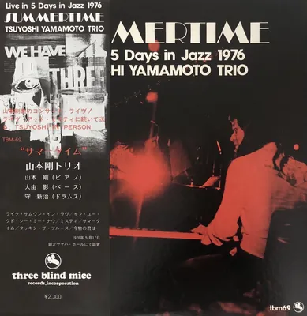

<!-- tbm-liner-cover:start -->

TBM-69<b>Summertime</b><small>Тріо Цуйоші Ямамото, 1976</small><a href="../Альбоми/TBM-69">Сторінка альбому →</a>

<!-- tbm-liner-cover:end -->

# SUMMERTIME (Літня пора)
## TSUYOSHI YAMAMOTO TRIO (Тріо Цуйоші Ямамото)

---

### СПИСОК КОМПОЗИЦІЙ

**< Сторона A >**
1. **LIKE SOMEONE IN LOVE (Немов закоханий)** 
   (James Van Heusen - Jonny Burke) ........................................ 8'40"
2. **IF YOU COULD SEE ME NOW (Якби ти могла бачити мене зараз)** 
   (Tadd Dameron) ..................................................................... 6'30"
3. **MISTY (Місті)** 
   (Erroll Garner) ........................................................................ 7'43"

**< Сторона B >**
1. **SUMMERTIME (Літня пора)** 
   (George Gershwin) .................................................................. 7'55"
2. **COOKIN' THE BLUES (Куховарячи блюз)** 
   (Tsuyoshi Yamamoto) ............................................................ 7'51"
3. **THE WAY YOU LOOK TONIGHT (Те, як ти виглядаєш сьогодні)** 
   (Jerome Kern - Dorothy Fields) ............................................... 7'10"

---

### УЧАСНИКИ ТА СТВОРЕННЯ АЛЬБОМУ

* **TSUYOSHI YAMAMOTO ([[Артист — Цуйоші Ямамото|Цуйоші Ямамото]])** — фортепіано
* **AKIRA DAIYOSHI (Акіра Даййоші)** — бас
* **SHINJI MORI ([[Артист — Шінджі Морі|Шінджі Морі]])** — ударні

* **Продюсер:** TAKESHI FUJII (Такесі Фудзії) для THREE BLIND MICE Records, Inc.
* **Звукорежисер (Recording Engineer):** YOSHIHIKO KANNARI (Йошіхіко Каннарі) (Epicurus)
* **Інженер мастерингу (Cutting Engineer):** MITSUHARU KOBAYASHI (Міцухару Кобаяші) (Toshiba-EMI)
* **Арт-директор:** BEN NISHIZAWA (Бен Нішізава)
* **Фото обкладинки (Cover Photo):** BEN NISHIZAWA (Бен Нішізава), AKIRA AIMI (Акіра Аймі)
* **Анотації до альбому (Liner Notes):** TAKEO FUJII (Такесі Фудзії)
* **Керівники (Executives):** K. SAGA, A. FUKUTOMI

**Записано наживо 17 травня 1976 року під час концерту "5 Days in Jazz '76" у Ginza Yamaha Hall, Токіо.**

---

## 《Рецензія》 
**Такесі Фудзії (Takeo Fujii)**

**1. Перехід від «часткового існування» до «цілісного існування»** 
— Тонкі зміни в грі [[Артист — Цуйоші Ямамото|Цуйоші Ямамото]] —

[[Артист — Цуйоші Ямамото|Цуйоші Ямамото]], який дебютував як комета у травні 1974 року з альбомом «Midnight Sugar» ([[TBM-23]]) на лейблі Three Blind Mice Records, відтоді невпинно розвивався і тепер міцно закріпив за собою позицію провідного музиканта мейнстріму на японській джазовій сцені.
Після «Midnight Sugar» він випустив альбом «Misty» ([[TBM-30]]), який отримав Джазову дискову премію журналу SJ і приніс йому широке визнання (можна сказати, що це було великим щастям у цьому сенсі), концертний альбом «Live at the Misty» ([[TBM-37]]), записаний у джаз-клубі «Misty» в Роппонгі, «Blues for Tee» ([[TBM-41]]), «The In Crowd» ([[TBM-52]]), альбом гурту Yama & Jiro's Wave (з Тецудзіро Обарою) «Girl Talk» ([[TBM-59]]), а також альбом з лейблу East Wind — «Daffodil». Той факт, що він випустив цілих 7 лідерських альбомів лише за два роки і що джаз-клуб «Misty», де він виступає майже щовечора, щодня переповнений людьми, які насолоджуються його грою до пізньої ночі, свідчить про його неймовірну популярність.

Однак, крім цих зовнішніх успіхів, він неухильно здійснює і глибоку внутрішню трансформацію.
Як вже зазначали багато людей, його гра має красиву ліричну мелодику і тон, блюзове відчуття рідкісного для японців масштабу і багату пісенність, а з іншого боку, пряму експресію, яку можна назвати навіть примітивною (primitive) з її потужним дотиком (touch) і великим об'ємом звуку. Це демонструє маскулінність, а також свіже відчуття сучасності (now-feeling), притаманне молодій людині, яка живе в теперішньому часі. Це надзвичайно унікальний і сповнений чарівності стиль.

Не можна сказати, що ця чарівність якось змінилася, але якщо слухати уважно, то здається, що, починаючи десь із альбому «Girl Talk», у його грі почали відбуватися тонкі, але важливі зміни.
По-перше, у цьому альбомі, який був його першим записом після повернення з Америки, окрім звичної красивої ліричної мелодики, можна відчути ледь помітний присмак соулу або року. Він сам нещодавно сказав: «У рок- та соул-музиці є багато чудових пісень. Я хочу обробити їх у стилі Ямамото і зіграти не на електричному, а на акустичному піаніно. Не знаю, що з цього вийде, але...». Ймовірно, саме це розширення його музичних інтересів природно надає його грі відчуття соулу, навіть коли він виконує джазові стандарти.

Друга зміна — це явне посилення акценту на взаємодії (inter-play) у комбо, що особливо помітно в його останньому альбомі «Daffodil» та інших. За його власними словами, раніше, покладаючись на свою молодість, він вкладав усі сили лише в ті частини імпровізації, які були відведені йому. Тобто його головним пріоритетом було те, як найкраще проявити себе. Але нещодавно він прийшов до усвідомлення того, що потрібно створювати чудову гру разом з усіма учасниками, і почав приділяти увагу всьому ансамблю, щоб кожен учасник міг повною мірою розкрити свої можливості. Тобто він більше не висувається постійно на перший план, а знаходить своє місце в цілому, уважно ставлячись до того, як вступати і як передавати хід, і граючи так, щоб забезпечити баланс. Це означає збільшення «ніжності» (yasashisa) в його музиці, але водночас це також означає збільшення «суворості» (kibishisa), оскільки він вимагає такої ж уваги і від інших учасників. Ця тонка, але важлива зміна — від «часткового існування» до «цілісного існування», що підтримується збільшенням «ніжності, яка вимагає суворості», — мабуть, є найяскравішою особливістю його останніх виступів.

Що ж принесло такі зміни в його музику? Можна сказати, що багато в чому, якщо не повністю, це стало результатом його піврічного досвіду перебування в Америці з січня по липень 1975 року.
У січні 1975 року він вирушив до Бостона з метою навчання в музичному коледжі Берклі (Berklee), але, приїхавши туди, не знайшов у школі нічого, чого б хотів навчитися. Тому він часто залишався сам у своїй квартирі і мовчки тренувався на орендованому фортепіано або грав на альт-саксофоні (позиченому у друга). Озираючись назад, це був надзвичайно цінний досвід, оскільки він отримав чудову нагоду зазирнути у свою власну музику, чого він не міг легко зробити в Японії. За три місяці він залишив Бостон і переїхав до Нью-Йорка, де, за теплої підтримки [[Артист — Йошіакі Масуо|Йошіакі Масуо]] (Yoshiaki Masuo), який вже активно там працював, він мав змогу стикатися з різноманітною музикою та працювати професіоналом двічі на тиждень у джаз-клубах. Хоча це були виступи в дуеті з басистом, необхідність взаємодії з партнером у цьому форматі, разом з його самотніми репетиціями в Бостоні, значною мірою вплинули на його стиль гри, і я думаю, що це призвело до згаданих вище змін у важливості взаємодії (inter-play).

Цей виступ, де він, зберігаючи цей цінний досвід з Америки, поступово демонструє зміни у своїй грі в суворих умовах, для деяких слухачів може здатися менш переконливим (thin) порівняно з його попередньою силою (tsuyosa), створюючи враження дещо бракує тієї сили, яка б захоплювала слухача. Зокрема, ті, хто був глибоко занурений у його попередню гру, частіше мають таке відчуття. Отже, ця зміна від «часткового існування» до «цілісного існування», яку він демонструє зараз, має для його шанувальників певний ризик, схожий на ходіння по канату (tsunawatari), оскільки залежно від подальшого розвитку це може призвести до втрати інтересу. Враховуючи його нинішнє становище, він міг би продовжувати заробляти багато грошей і підтримувати свою популярність лише на основі своєї попередньої чарівності. Чому ж він вирішив шукати таких небезпечних змін саме в цей час? Він каже: «Саме тому, що зараз такий час». Я вважаю, що цей позитивний дух — це найбільший результат, який він отримав завдяки своєму досвіду в Америці. І якщо він зможе зберегти цей дух, він, без сумніву, успішно впорається з цим небезпечним «ходінням по канату», яке тільки почалося. Ми, його віддані шанувальники, повинні відповісти на це, посилаючи теплі оплески за його сміливість кинути собі виклик.

**2. Про цей альбом**
Перш ніж перейти до обговорення цього альбому, давайте коротко простежимо за діяльністю Ямамото після його повернення з Америки. Після повернення в липні 1975 року він деякий час був вільним художником (free) і час від часу виступав із тимчасово зібраними тріо в таких місцях, як джаз-клуб «Junk» у Ґіндзі. Але після літнього джазового фестивалю (Summer Jazz Festival) наприкінці серпня він створив тріо під назвою «Yama & Jiro's Wave» разом з Тецудзіро Обарою на барабанах і Акірою Даййоші на басі, і водночас відновив свою активну діяльність як постійний піаніст (house pianist) у джаз-клубі «Misty». Це тріо «Yama & Jiro's Wave» записало альбом «Girl Talk» для Three Blind Mice, але, на жаль, воно розпалося в лютому цього року. З того часу Ямамото продовжує виступати як тріо в місцях, окрім «Misty», маючи лише Акіру Даййоші як постійного басиста, а барабанщиків запрошуючи час від часу (зараз до них приєднався [[Артист — Стів Джексон|Стів Джексон]], який повернувся з Америки). Тим часом у березні та квітні цього року він брав участь у комбо Кенні Баррелла (Kenny Burrell) та [[Артист — Ісао Судзукі|Ісао Судзукі]], намагаючись взаємодіяти з іншими музикантами. В даний час він бере участь у групі свого старого друга [[Артист — Ісао Судзукі|Ісао Судзукі]], активно прагнучи до власного перетворення (henkaku) в довгостроковій перспективі. Цей альбом має характер своєрідного проміжного звіту (keika hokoku) про цю недавню позитивну та активну діяльність.

Цей альбом є 8-м лідерським альбомом Ямамото і водночас одним з концертних альбомів, записаних на "5 Days in Jazz '76". Цьогорічний фестиваль "5 Days in Jazz '76" проходив протягом 5 днів — з 17 по 18 травня та з 25 по 27 травня, а місце проведення перемістилося з торішнього Nihon Toshi Center Hall до Ginza Yamaha Hall.

Тріо [[Артист — Цуйоші Ямамото|Цуйоші Ямамото]] виступало в перший день під назвою «Вечір джазового фортепіано» і стало завершальним актом після виступу тріо Фуміо Карашіми. Учасниками тріо того дня були [[Артист — Цуйоші Ямамото|Цуйоші Ямамото]] (фортепіано), Акіра Даййоші (бас) та [[Артист — Шінджі Морі|Шінджі Морі]] (ударні). [[Артист — Шінджі Морі|Шінджі Морі]] привертає увагу своїм приєднанням до складу. Зараз він є учасником квартету Садао Ватанабе (Sadao Watanabe Quartet) і є талановитим музикантом (jitsuryoku-ha), який минулого року брав участь у джазовому фестивалі в Монтре (Montreux Jazz Festival). Його гра на барабанах вирізняється надзвичайно безпомилковим відчуттям ритму, як у годинника (time-keep), а також sắc bén (sharpness) і cool відчуттям, що створює надзвичайно міське (urban) враження. Бас Даййоші має в'язке відчуття (nebarike no aru feeling), яке здається дещо сільським (inakata-teki) порівняно з барабанами, неначе обвиваючись навколо них. До цих двох приєднався Ямамото, і було дуже цікаво послухати, яку музику вони створять разом ще до початку виступу. Насправді сам Ямамото після виступу також сказав, що оскільки він грав з Морі (на барабанах), він зміг зіграти з новим і свіжим відчуттям напруги.

Давайте коротко розглянемо композиції.
Перша композиція на стороні А починається з тихого вступу (introduction) і поступово збільшує кількість звуків і швидкість, переходячи до теми. Хоча це була перша композиція першого дня фестивалю, тріо одразу ж увійшло в потрібний настрій і чудово виконує цю головну тему (theme song) з фільму «Юконська красуня» (Belle of the Yukon, 1944), яку співала Діна Шор (Dinah Shore). Ямамото демонструє навмисне швидку, агресивну гру на фортепіано, тягнучи групу за собою. Тут відчувається його сила як лідера, який прагне якомога швидше залучити всіх учасників у концертний настрій. Разом з тим, вже з цієї першої композиції можна помітити тонку увагу Ямамото до взаємодії (inter-play), наприклад, у переплетенні фортепіано з басом та барабанами під час соло Даййоші та Морі, або у передачі ходу (uke-watashi) від цих соло.

Друга композиція, коли тріо починає відчувати себе спокійніше на сцені (butai de no ochitsuki), — це фірмова повільна балада Ямамото. Тут добре відчувається масштаб його музики в цьому повільному темпі (slow na kyoku).

Третя композиція починається з довгого фортепіанного соло-вступу (unaccompanied piano solo intro), під час якого в уяві постають образи різних пісень, а потім ми чуємо тему знайомої нам пісні «Misty». Зберігаючи мелодійність і еротизм (eroticism) Ерролла Гарнера (Erroll Garner), він повністю засвоїв їх у своєму власному стилі, і ця «Місті», маючи надзвичайно сучасне відчуття (modern feeling), є справді гідною композицією.

Перша композиція на стороні B — це «Summertime», у якій на всьому протязі звучить (feature) бас Даййоші. Завдяки техніці щипків (tsumabiki) та гри смичком (yumihiki), а також унісону (unison), Даййоші повною мірою розкриває свої можливості, і ми можемо сповна насолодитися його важким, земним, але водночас багатим на пісенність басом.

Друга композиція — це оригінальний твір Ямамото «Cookin' the Blues». Це один з його улюблених номерів, і є тією самою композицією (dodikyoku), що і «Speed Ball Blues» з альбому «Blues for Tee» ([[TBM-41]]) та «Blues» з альбому «Misty» ([[TBM-30]]), які є розвитком його попередніх робіт (а також композиція з такою ж назвою «Blues» у новому альбомі [[Артист — Ісао Судзукі|Ісао Судзукі]] «Black Orpheus» ([[TBM-63]])). Оскільки це пісня, над якою він довго працював і відшліфовував, його гра тут має великий розмах і впевненість, і в розслабленій атмосфері він дозволяє нам почути комфортне виконання з вільним і потужним драйвом (drive).

Щодо останньої композиції, «The Way You Look Tonight» (Те, як ти виглядаєш сьогодні), багато слів не потрібно. Серед відчуття свінгу, яке переповнює цей твір, сила Ямамото та його сучасність (modernity) справді чудово поєднані, роблячи його захоплюючим виступом (nori ni notta kaien), гідним завершення альбому.

Отже, слухачі, як ви почуваєтеся після прослуховування? Чи не здається вам, що він, не втративши своєї попередньої чарівності (yosa), зараз чудово демонструє нам цей перехід від «часткового існування» до «цілісного існування», як я описав вище?
