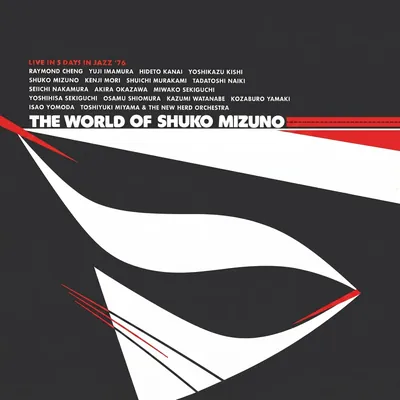

<!-- tbm-liner-cover:start -->

TBM-70<b>The World of Shuko Mizuno</b><small>Шуко Мізуно &amp; Тосіюкі Міяма та New Herd, 1976</small><a href="../Альбоми/TBM-70">Сторінка альбому →</a>

<!-- tbm-liner-cover:end -->

# THE WORLD OF SHUKO MIZUNO (Світ Шуко Мізуно)

---

### СПИСОК КОМПОЗИЦІЙ

**< Сторона A >**
1. **DUM (Дам)** (Shuko Mizuno) ........................................................................ 13'28"
   **SHUKO MIZUNO COMBO II**
   * [[Артист — Кенджі Морі|Кенджі Морі]] (Kenji Mori) — дерев'яні духові
   * Йошіхіса Секігучі (Yoshihisa Sekiguchi) — тенор-саксофон
   * Раймонд Чен (Raymond Cheng) — електрична скрипка
   * Шуко Мізуно (Shuko Mizuno) — синтезатор та ударні
   * [[Артист — Мівако Секігучі|Мівако Секігучі]] (Miwako Sekiguchi) — фортепіано
   * [[Артист — Хідето Канаї|Хідето Канаї]] (Hideto Kanai) — бас
   * Ісао Йомода (Isao Yomoda) — ударні
   * Юдзі Імамура (Yuji Imamura) — перкусія
   * [[Артист — Тадатоші Найкі|Тадатоші Найкі]] (Tadatoshi Naiki) — електрик-оператор

2. **CONCENTRATION (Концентрація)** (Shuko Mizuno) ......................................... 7'44"
   **SHUKO MIZUNO COMBO I**
   * [[Артист — Сеїчі Накамура|Сеїчі Накамура]] (Seiichi Nakamura) — тенор-саксофон
   * [[Артист — Йошікадзу Кіші|Йошікадзу Кіші]] (Yoshikazu Kishi) — труба
   * [[Артист — Осаму Шіомура|Осаму Шіомура]] (Osamu Shiomura) — тромбон
   * [[Артист — Кадзумі Ватанабе|Кадзумі Ватанабе]] (Kazumi Watanabe) — гітара
   * Раймонд Чен (Raymond Cheng) — електрична скрипка
   * Шуко Мізуно (Shuko Mizuno) — електричне піаніно
   * Козабуро Ямакі (Kozaburo Yamaki) — гітара
   * Акіра Оказава (Akira Okazawa) — бас
   * [[Артист — Шуїчі Муракамі|Шуїчі Муракамі]] (Shuichi Murakami) — ударні
   * Юдзі Імамура (Yuji Imamura) — перкусія

**< Сторона B >**
1. **JAZZ ORCHESTRA '75 PART II (Джазовий оркестр '75 Частина II)** (Shuko Mizuno) ................... 27'08"
   **TOSHIYUKI MIYAMA and the NEW HERD ORCHESTRA PLUS ALL STAR GUESTS**
   **(Гості)**
   * [[Артист — Сеїчі Накамура|Сеїчі Накамура]] (Seiichi Nakamura) — тенор-саксофон
   * [[Артист — Кенджі Морі|Кенджі Морі]] (Kenji Mori) — альт-саксофон
   * [[Артист — Кадзумі Ватанабе|Кадзумі Ватанабе]] (Kazumi Watanabe) — гітара
   * Акіра Оказава (Akira Okazawa) — електричний бас
   * [[Артист — Шуїчі Муракамі|Шуїчі Муракамі]] (Shuichi Murakami) — ударні
   * Юдзі Імамура (Yuji Imamura) — конги

---

### СТВОРЕННЯ АЛЬБОМУ
* **Продюсер:** TAKESHI FUJII (Такесі Фудзії) для THREE BLIND MICE Records, Inc.
* **Звукорежисер (Recording Engineer):** YOSHIHIKO KANNARI (Йошіхіко Каннарі) (EPICURUS)
* **Інженер мастерингу (Cutting Engineer):** MITSUHARU KOBAYASHI (Міцухару Кобаяші) (Toshiba-EMI)
* **Арт-директор:** BEN NISHIZAWA (Бен Нішізава)
* **Фото обкладинки (Cover Photo):** BEN NISHIZAWA (Бен Нішізава), AKIRA AIMI (Акіра Аймі), NORIHISA KATO (Норіхіса Като)
* **Анотації до альбому (Liner Notes):** TAKEO FUJII (Такесі Фудзії)
* **Керівники (Executives):** K. SAGA, A. FUKUTOMI

**Записано наживо під час концерту "The World of Shuko Mizuno", 26 травня 1976 року в Ginza Yamaha Hall, Токіо.**

---

## 《Рецензія》 
**Такесі Фудзії (Takeo Fujii)**

**1. Про Шуко Мізуно**
Шуко Мізуно продовжує справляти великий вплив на сучасний джаз та сцену сучасної музики завдяки своїм творам «Jazz Orchestra '73» та «Jazz Orchestra '75», спираючись на лейбл Three Blind Mice Records. Оскільки його музична історія до цього часу не часто висвітлювалася в анотаціях, я хотів би представити її тут і водночас прояснити процес його взаємодії з джазом та його мислення.

**① 1957 — 1961 роки**
У березні 1957 року він закінчив факультет літератури та науки Університету Чіба (спеціальність юриспруденція), а у квітні того ж року вступив на відділення композиції Токійського університету мистецтв. Там він навчався у двох професорів: Міни Сібати, видатного діяча сучасного музичного світу, та Фуміо Коїдзумі, провідного фахівця з народної музики, що мало велике значення. Але найбільший вплив на музику Мідзуно в подальшому справив його однокурсник Такехіса Косугі, який зараз активно працює в «Taj Mahal Travellers». Не буде перебільшенням сказати, що їхня зустріч пробудила в Мідзуно інтерес до колективної «імпровізації». 
Мідзуно грав на віолончелі, а Косугі на скрипці в комбо, і в рік закінчення університету (1961) вони створили групу під назвою «Group Ongaku» та виконували імпровізації разом з танцюристами модерну. Після закінчення університету, у 1962 році, дует з Косугі творчо розпався; Косугі поїхав до Америки, захопившись Джоном Кейджем, а Мідзуно рухався у напрямку організованої музики, десь між роллю композитора та імпровізатора.

**② 1962 — 1967 роки**
Це був період, коли він створював багато оркестрових композицій, і його найрепрезентативнішою роботою того часу став твір 1961 року «Three Dimensions for Brass Group» («Три виміри для мідної групи»), написаний для 4 труб, 4 валторн, 4 тромбонів та 1 туби. Другою роботою була композиція «Autonomy for Voices» («Автономія для голосів») з його «Концерту творів Шуко Мізуно» 1964 року, а третьою — «Orchestra 1966», написана для Пре-Експо у 1966 році. Щодо «Orchestra 1966», то сам Мідзуно називає її своїм найкращим твором, оскільки вона поєднує в собі і композицію, і імпровізацію, і все, що знаходиться між ними.
Крім того, як легко уявити, перша і третя з цих композицій проклали шлях до ідей його пізніших робіт «Jazz Orchestra '73» та «Jazz Orchestra '75», і тому вони є дуже важливими при розгляді його джазової діяльності. З іншого боку, з часів навчання в середній школі Мідзуно був знайомий із джазом і також створював ряд творів, багатих на джазові ідіоми, під назвою «Compositions on Japanese Melodies» (Композиції на японські мелодії), що були паралельними до вищезгаданого напрямку.
Однак до цього часу його музика в основному була пошуком чогось без біту (non-beat). Це був пошук звуку як живої сили з точки зору японців, тобто аграрних народів і Кендо, а не нерегулярного біту. Зрозуміти одну з тенденцій його музики того часу можна через композицію «Autonomy of Voice» (TA 7030) із серії «Сучасні японські композитори» лейблу Toshiba.

**③ 1967 — 1968 роки**
У квітні 1967 року він відвідав курс «Теорія джазу» Садао Ватанабе в музичній школі Yamaha в Ебісу, і протягом наступних двох років без жодного пропуску навчався джазу в Набе-сана. Зрештою до кінця курсу залишилося лише 6 студентів, але, як кажуть, у ньому брали участь багато цікавих людей, наприклад, [[Артист — Масахіко Тогаші|Масахіко Тогаші]] з «Spiritual Nature» та Кензо Накагава з гурту флейтистів. Два роки навчання у Садао Ватанабе стали надзвичайно важливим періодом, який відкрив йому очі на нові аспекти музики, яких не навчали в Університеті мистецтв, такі як «свінг» і «біт». Навіть більше, він також активно працював піаністом у джаз-клубі «Bossa Tempo» в Роппонгі, докладаючи багато зусиль для вивчення джазових ідіом, беручи уроки у Масанобу Судзукі, який на той час грав в оркестрі High Society в університеті Васеда. І останнім завданням у класі Ватанабе була композиція, яка сподобалася [[Артист — Хідето Канаї|Хідето Канаї]], басисту, і разом з іншим твором «Kari-sho» вона була записана на альбомі гурту «Kings Roar» Канаї — «Original» (Teichiku) у 1969 році.

**④ 1969 — 1973 роки**
Вперше надавши джазову композицію для [[Артист — Хідето Канаї|Хідето Канаї]] та Kings Roar у 1969 році, у травні 1971 року він на прохання президента Такесі Фудзії написав оригінальну композицію «April Song For Kanai: Zui-Zui-Zui-Du-Tubadaba» для альбому «Q» групи [[Артист — Хідето Канаї|Хідето Канаї]] на лейблі Three Blind Mice. Цей твір, в якому звучали два альт-саксофони [[Артист — Косуке Міне|Косуке Міне]] та Алана Праскіна, а також секстет із труби, баритона, фортепіано, баса та барабанів, створив досить потужне звучання і може розглядатися як попередник його подальших робіт. Після цього, отримавши величезну підтримку від продюсера Такесі Фудзії, він почав серйозно випробовувати себе у створенні повноцінного оркестрового джазу.
І ось у 1973 році був завершений монументальний твір «Jazz Orchestra '73», який отримав визнання як перший справжній сучасний оркестровий джаз у Японії завдяки надзвичайно новаторським методам аранжування та приголомшливо потужному виконанню, сповненому свінгу та біту. Тим часом у сфері сучасної музики також щороку десь виконувалася композиція «Autonomy of Sound», починаючи з 1968 року, а «Orchestra 1966» була виконана симфонічним оркестром NHK на «Виставці сучасної музики» 1973 року, за що отримала нагороду, здобувши ще вищу оцінку, ніж раніше.

**⑤ Після 1973 року**
Одного разу він отримав несподіване запрошення і в жовтні 1973 року вирушив на рік навчатися до Америки. Ця стипендіальна програма, яка є однією з найкращих без будь-яких зобов'язань, запросила чотирьох видатних митців у сфері музики: Тору Такеміцу, Юджі Такахаші, Тоші Ічіянагі та Шуко Мізуно. В Америці він продовжував вільно досліджувати музику, переважно в Нью-Йорку, і за цей час композиція «Jazz Orchestra '73» також транслювалася на кількох FM-радіостанціях Америки, викликавши великий резонанс. Повернувшись після навчання з розширеними горизонтами в лютому 1975 року, він знову отримав замовлення від продюсера Фудзії з TBM на створення твору «Jazz Orchestra '75» як пам'ятного проекту до 5-річчя компанії. Протягом 5 місяців з лютого він розробляв концепцію, а потім протягом 2 місяців з липня присвятив понад 15 годин щодня написанню партитури цього твору, завершивши монументальну роботу обсягом понад 200 сторінок. Цей твір, як і попередня робота, виконувався оркестром Toshiyuki Miyama & The New Herd з найкращими солістами: [[Артист — Сеїчі Накамура|Сеїчі Накамура]] (ts), [[Артист — Кенджі Морі|Кенджі Морі]] (as), [[Артист — Кадзумі Ватанабе|Кадзумі Ватанабе]] (g) з джазової сцени, а також Акіра Оказава (el-b) і [[Артист — Шуїчі Муракамі|Шуїчі Муракамі]] (ds) з рок-сцени, і ритм-секцією під керівництвом Юдзі Імамури (perc). Він був записаний 3 вересня 1975 року. Це той самий оригінальний твір, частина якого записана на стороні B цього альбому (TBM 1004).

Однак його багатогранна діяльність не обмежувалася цим; того ж року він написав композицію «Maboroshi» (Ілюзія) для Токійського хору мовлення, який брав участь у Мистецькому фестивалі NHK, і отримав нагороду за видатні досягнення. В цьому творі також відчувається глибокий зв'язок з «'75», оскільки одна третина твору є скат-хором, а також використовуються ударні Імамури як супровід і впроваджуються елементи року.

**2. Тосіюкі Міяма та The New Herd**
З іншого боку, з огляду на його недавні тісні зв'язки з джазом Шуко Мізуно, слід відзначити Тошіюкі Міяму та The New Herd, які відіграють надзвичайно важливу роль у реалізації його задумів.
Як незвичайне явище в недавньому джазовому світі Японії, часто кажуть, що біг-бенд джаз переживає період застою. В рамках цієї тенденції три сім'ї (three families) — Nobuo Hara & Sharps and Flats, Tatsuya Takahashi & Tokyo Union та The New Herd — докладають усіх зусиль, повністю розкриваючи свій потенціал і демонструючи чудові виступи в різних місцях. І я вважаю, що успішні виступи The New Herd на двох великих фестивалях у Монтре та Ньюпорті минулого року значною мірою стимулювали цю тенденцію.
Не вдаючись у подробиці про The New Herd, оскільки останнім часом вони випустили багато альбомів і отримали багато рецензій, я б хотів особливо підкреслити, що серед цих біг-бендів The New Herd здавна активно беруть участь у нових, прогресивних починаннях. Тобто вони є всебічно розвиненим оркестром (all-round orchestra), який здатний зіграти в будь-якому стилі завдяки своєму багатому звучанню та потужному драйву. У той час як вони можуть зіграти популярні композиції, такі як номери Еллінгтона, так розслаблено, що краще вже й не придумати, вони продовжують свої сміливі та креативні пошуки: від серії «New Herd Modern Jazz Series» (Nippon Columbia) у 1969 році та «Perspective», участі у творах [[Артист — Масахіко Сато|Масахіко Сато]] «Tenbinza no Shi» та «Ohitsujiza no Shi» або у «Free Jazz Big Festival» у 1973 році, до «Sound of the Earth - Poetic Sentiment in Japanese Legends» (Nippon Columbia) у січні 1974 року, а також виступів з новими творами на «Free Concert» Йоґецу Мікадо з травня 1972 року. Їхня непохитна любов і зусилля щодо «японського джазу», які особливо проявляються в їхньому ентузіазмі до японських музичних форм і використання матеріалу, заслуговують на особливу увагу.
«Jazz Orchestra '75» — це одна з таких спроб The New Herd, і здається, що без них, разом з «Jazz Orchestra '73», було б неможливо завершити оркестрові джазові твори Шуко Мізуно, які вимагають таких екстремальних технічних навичок і фізичних зусиль.

**3. Про "5 Days in Jazz" та композиції альбому**
Четвертий день "5 Days in Jazz" цього року мав назву «Світ Шуко Мізуно». Концерт розпочався з Комбо I «Concentration», за яким послідувало Комбо II «Dum», а після них, що привернуло найбільше уваги, прозвучали 1 і 2 частини «Jazz Orchestra '75». У цьому альбомі на стороні A записано Комбо II першим, а потім Комбо I у зворотному порядку, а на стороні B повністю представлена 2 частина «Jazz Orchestra '75». Давайте послухаємо їх в порядку запису на альбомі.

**① Комбо II — «Dum» (Дам)**
Починається з синтезатора Мідзуно, і після своєрідного космічного відчуття, підсиленого скрипкою Раймонда Чена, який останнім часом активно виступає з групою Мікіо Масуди, бас [[Артист — Хідето Канаї|Хідето Канаї]] прорізає простір, за яким яскраво проявляється контраст між спокоєм і рухом, білим і чорним завдяки фортепіано [[Артист — Мівако Секігучі|Мівако Секігучі]]. До цього додається тенор Йошіхіси Секігучі, роблячи контраст ще більш виразним, а вигуки (kiai no kakegoe) фортепіано, баса, ударних (Мідзуно) та скрипки Чена гармонізують (wa shite iku) все це. Потім настає соло на конгах Імамури і на дерев'яних духових інструментах Морі, розвиваючись у бік образу фестивалю. Ці образи трансформуються в інтенсивний перетин звуків завдяки участі всіх інструментів по черзі, і в кінці ведуть до завершення (ending), де весь простір щільно заповнюється всіма можливими звуками енергії (energi- ni yotte mattaku mitsudo ni umetsukusarete iku). Хоча ця композиція була написана незадовго до цього дня, її справжньою метою було не виразити унікальні для японців концепції, такі як «дух» (kiai) або «пауза» (ma), чи образ «фестивалю» (matsuri) через просто японський світ (nihonteki na sekai), а скоріше об'єднати всі ці звуки, які неможливо виразити звичайними музичними нотами. І оскільки ядром виступу була група, яка зазвичай звикла до такого роду гри, починаючи з Йошіхіси Секігучі (Yoshihisa Sekiguchi), що належить до течії нового джазу, вони змогли повною мірою реалізувати задум Мідзуно, створюючи різноманітні зміни і жодного разу не дозволяючи слухачам занудьгувати.

**② Комбо I — «Concentration» (Концентрація)**
За словами Мідзуно, це Комбо I мало відігравати роль інтродукції до «Світу Шуко Мізуно» того дня, щоб слухачі могли увійти в його світ без відчуття дискомфорту. Ця композиція поділена на три частини A, B і C, і на цьому альбомі записана лише частина C. Вона починається з конг Імамури, одразу долучаються барабани, потім труба, і розгортається бурхливий (uzumaku you na) 8-бітовий світ, який слугує підготовкою до світу «Jazz Orchestra '75». Соло виконують по черзі [[Артист — Йошікадзу Кіші|Йошікадзу Кіші]] (tp), [[Артист — Осаму Шіомура|Осаму Шіомура]] (tb), [[Артист — Сеїчі Накамура|Сеїчі Накамура]] (ts), [[Артист — Кадзумі Ватанабе|Кадзумі Ватанабе]] (g), Раймонд Чен (Vn) та [[Артист — Шуїчі Муракамі|Шуїчі Муракамі]] (ds).

**③ «Jazz Orchestra '75» Частина II**
«Jazz Orchestra '75» був випущений як альбом у листопаді 1975 року, а згодом, у лютому 1976 року, він був виконаний на сцені в перший день «Виставки сучасної музики» (Gendai no Ongakuten) — «Вечір камерної музики» з тим самим чудовим складом учасників, що й на альбомі. Тоді він викликав шалені оплески шанувальників сучасної музики, які вщерть заповнили зал, але водночас і приголомшив їх, залишивши глибокий слід. Тому виступ на "5 Days in Jazz" у травні став другим виконанням на сцені, але це була прем'єра (hatsu-tojo) перед шанувальниками джаз-фанку. Цього разу вони також розгорнули чудовий виступ у найкращому складі і продемонстрували результат, який перевершує оригінальний студійний альбом.
Однак я маю попередити вас перед прослуховуванням цієї композиції на цьому альбомі. Оскільки на стороні B було записано всю Частину II, час звучання на одній стороні становить аж 27 хвилин. Це близько до межі можливостей для грамплатівки. Тому, щоб сповна насолодитися цим альбомом, необхідно слухати його з голкою (stylus), притискною силою (stylus pressure) та іншим обладнанням для відтворення в найкращому стані.

За словами Мідзуно, ця Частина II мала на меті «поєднати рок і симфонію в неймовірно хаотичний спосіб» (mechakucha ni rokku shinfoni- no yoso o motaseru). «Спочатку вона починається з робочої пісні з важким бітом (heavy beat), яка базується на мелодії "Yoitomake" та "Enya Kora". Друга половина Частини II переходить у шалено швидкий рок-біт, і було б чудово, якби всі були надзвичайно збуджені (excite)». З одного боку, Шуко Мізуно продовжував створювати звучання, яке сильно виділяє «відчуття біту» (beat-kan) — одну з найбільших чарівностей джазу, — а з іншого боку, його концепція зіткнення 4-бітних і 8-бітних ритмів (а іноді й їхнього злиття), яка, здається, не має аналогів у світі (marude rui o minai), була блискуче реалізована, і високо в регістрі гітара і труба шалено вирують (hageshiku uzumaki), низькі регістри глибоко і резонансно заповнюються електричним басом і барабанами (el-b to ds ga fukaku hibiki), а між ними щільно (mitsudo ni) заповнює простір секція саксофонів і тромбонів. Коли завершується довга частина tutti, починається довге, прекрасне гітарне соло [[Артист — Кадзумі Ватанабе|Кадзумі Ватанабе]]. Його видатна техніка демонструється тут повною мірою. Згодом знову вступає секція духових інструментів (brass and reed section), створюючи коротке tutti, і після соло на барабанах швидкість раптово зростає (ikki ni speed o mashite), переходячи до потужного (kyoretsu na) і масштабного tutti від усього ансамблю, де особливо виділяється напружена гра (kinchohari) секції труб New Herd. Незабаром після цього слідує альт-соло Морі у високому темпі. Потім — чудова гітара [[Артист — Кадзумі Ватанабе|Кадзумі Ватанабе]]. А після неї — інтенсивне переплетення (hageshii karami) тенора Накамури, який приєднався до них, і гітари. Взаємодія (karami) цих двох — це не просто взаємодія, а частина альбому, яка відчувається як середня частина, і вона триває з неймовірною інтенсивністю (iki oi) так, що майже немає перепочинку; можна сказати, що ця жвава розмова — це справді «Jazz Orchestra '75» і справжнє задоволення від живої імпровізації (live ban naradewa no ad-lib no daigomi). Після цього соло знову переходить до альта Морі, і все закінчується створенням масштабного tutti наприкінці.
