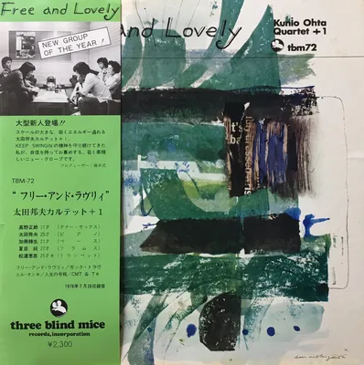

<!-- tbm-liner-cover:start -->

TBM-72<b>Free and Lovely</b><small>Квартет Куніо Оти + 1, 1976</small><a href="../Альбоми/TBM-72">Сторінка альбому →</a>

<!-- tbm-liner-cover:end -->

# “FREE AND LOVELY” (“Вільний і прекрасний”)

## KUNIO OHTA QUARTET + 1 (Квартет Куніо Охти + 1)

**Каталожний номер:** [[TBM-72]]
**Лейбл:** THREE BLIND MICE RECORDS, INC.

---

## СПИСОК КОМПОЗИЦІЙ

### 〈Сторона A〉
1. **FREE AND LOVELY / Вільний і прекрасний** (Куніо Охта) — 19'10"

### 〈Сторона B〉
1. **GOTTA TRAVEL ON / Мушу рушати далі** (Традиційна) — 7'30"
2. **WHAT ARE YOU DOING THE REST OF YOUR LIFE? / Що ти робитимеш усе своє подальше життя?** (Тед Колер – Бартон Лейн) *(Примітка: у буклеті авторів вказано помилково; справжні автори цієї пісні — Мішель Легран та Алан і Мерилін Бергмани)* — 4'57"
3. **CMT & T** ([[Артист — Такехіро Хонда|Такехіро Хонда]]) — 9'35"

---

## СКЛАД ВИКОНАВЦІВ (KUNIO OHTA QUARTET + 1)

* **Масамікі Такано (Masamiki Takano)** — тенор-саксофон
* **Куніо Охта (Kunio Ohta)** — фортепіано
* **[[Артист — Масаші Като|Масаші Като]] (Masashi Kato)** — бас
* **[[Артист — Джун Нацуме|Джун Нацуме]] (Jun Natsume)** — ударні
* **[[Артист — Кацухіко Мацуура|Кацухіко Мацуура]] (Katsuhiko Matsu-ura)** — труба (на Стороні B, треки 1 та 3)

---

## КОМАНДА ПРОЄКТУ

* **Продюсер:** Такесі Фудзії (Takeshi Fujii) для THREE BLIND MICE Records, Inc.
* **Звукорежисер (мікшер):** Йошіхіко Каннарі (Yoshihiko Kannari) [EPICURUS]
* **Асистенти звукорежисера:** Норіо Угаї (Norio Ugai), Юкіфумі Іто (Yukifumi Ito) [WING]
* **Інженер нарізки (каттингу):** Міцухару Кобаяші (Mitsuharu Kobayashi) [Toshiba-EMI]
* **Артдиректор:** Бен (Цутому) Нішідзава (Ben Nishizawa)
* **Коментарі (анотації):** Такесі Фудзії (Takeshi Fujii)
* **Виконавчі директори (сприяння):** Кадзуміцу Сага (K. Saga), Акінорі Фукутомі (A. Fukutomi)
* **Чай та підтримка (Tea & Sympathy):** Кенджі Морі (Kenji Mori), Масару Шімідзу (Masaru Simizu)

**Дата запису:** 26 липня 1976 року
**Місце запису:** Центр Yamaha Higashiyama в Нагої — Studio Wing, Нагоя

---

## 《Коментар》
**Такесі Фудзії**

Я надзвичайно радий, що можу представити тут зовсім нових талантів — вперше за досить довгий час для лейблу Three Blind Mice. Мабуть, крім частини найпалкіших шанувальників у Нагої, для всіх інших це абсолютно невідомі імена. Річ у тім, що відкривати й вирощувати новачків — справа надзвичайно важка. Моя звична манера створювати дебютні альбоми, залучаючи до сайдменів уже відомих музикантів або людей, які встигли засвітитися на сцені, цього разу відійшла на другий план. Цей третій альбом, створений у Нагої, став результатом того, що в серпні минулого року після запису сольної платівки Сунао Вади я завітав до нагойського клубу «Nica», щоб послухати гру тенор-саксофоніста на ім'я Масамікі Такано.

Перш ніж розповісти про виступ Квартету Куніо Охти тут, дозвольте мені трохи пояснити передісторію. Справа в тому, що, спостерігаючи за сучасною ситуацією у світі джазових платівок, не можна не помітити, що покупці завжди шукають уже відомі імена. Платівки абсолютно невідомих гуртів насправді продаються дуже погано. І це найболючіший момент для звукозаписної компанії.

Їхня гра тієї ночі, якщо говорити відверто, була значно сирішою та неоковирнішою, ніж на цій платівці, а в ритмі то тут, то там траплялися збої, які одразу впадали у вуха. Проте у грі Такано та Охти було щось таке, що перекривало ці недоліки — якась чистота, щира цілеспрямованість і по-справжньому прекрасне звучання. Моє враження було таким: якщо цей гурт не зупиниться і продовжить старанно працювати над собою, з них вийде щось надзвичайно цікаве.

Тому я сказав їм: «Давайте спробуємо записатися 26 липня. Це ще не офіційний запис! Якщо вийде добре — можливо, випустимо платівку, тож грайте невимушено і в своє задоволення. Але цей місяць до запису репетируйте до сьомого поту, домовилися?».

24 липня ці п'ятеро виступили на сцені табору «Nemu Jazz Inn». Вони зіграли три композиції: «Afreaka's Dance» Стіва Гроссмана, сольний номер Такано «What Are You Doing the Rest of Your Life?» та оригінал Охти «Free and Lovely». Оскільки це був їхній перший виступ на такій великій сцені, хлопці трохи скувалися, але плоди їхніх репетицій відчувалися сповна. Того дня більшість (десять) гуртів підготували програми з ухилом у модний нині 8-бітний кросовер, але те, що на цьому тлі наймолодші учасники впевнено вийшли з ортодоксальним 4-бітним джазом, залишило напрочуд приємне враження. До речі, людиною, яка порекомендувала Квартет Куніо Охти для участі в цьому «Nemu Jazz Inn» від Yamaha, був Кенджі Морі. Він же під час самої сесії звукозапису постійно був поруч і давав корисні поради молодим музикантам на чолі з Такано. Можна сказати, що він є хрещеним батьком цього альбому, тож я користуюся цією нагодою, щоб висловити йому свою глибоку вдячність.

Хоча наша початкова домовленість звучала як «давайте змонтуємо матеріал, і якщо вийде добре — видамо», коли ми записали перший же дубль (take one) композиції «Free and Lovely» і дали добро («ОК»), я вже твердо вирішив, що обов'язково випущу цю роботу у світ.

Усі п'ятеро музикантів, чиє звучання ви чуєте на цьому альбомі, — це чесні, молоді та надзвичайно симпатичні хлопці. І під час тієї сесії в кожному їхньому звуці втілилася їхня прямолінійна, життєрадісна та потужна гра. Позбавлений фальшивого блиску, міцно вкорінений у землю свінг — це те, що завжди приємно слухати.

---

### Коментарі до композицій

**«Free and Lovely»**
Цей масштабний і величний твір написав лідер гурту Куніо Охта. Композиція починається з трохи наївного, але свіжого звучання акустичного піаніно Охти, після чого тенор Такано піднесено виспівує величну мелодію. Увійшовши в 4-бітний ритм, він розгортає вільну та розмашисту імпровізацію. Протягом усього цього треку Такано демонструє напрочуд привабливу й потужну гру; тут абсолютно не відчувається жодної скутості, властивої новачкам. Далі естафету переймає фортепіано Охти — він видає чарівне, чисте й охайне соло, поступово вибудовуючи кульмінацію і повертаючи композицію до головної теми.
Наприкінці теми, під час коди, у ритмі стається ледь помітний збій, але оскільки сольні партії Такано та Охти були просто блискучими, ми вирішили зупинити свій вибір саме на цьому натхненному першому дублі.

**«Gotta Travel On»**
Композиція у стилі госпел, де одразу після інтро, оминаючи виклад теми, під енергійний ритм вступає труба Мацуури з яскравою імпровізацією (відчувається сильний вплив Кліффорда Брауна). Після соло Такано та Охти музика закінчується спільним виконанням мелодії, яка добре знайома кожному.

**«What Are You Doing the Rest of Your Life?»**
Сольний номер (шоукейс) Масамікі Такано. У цьому приємному баладному виконанні після каденції та переходу в ритм музика звучить по-справжньому свіжо, молодо, щиро та сучасно.

**«CMT & T»**
Блюз, що входить до альбому Такехіро Хонди «This Is Honda» (Trio Records). Назва складена з перших літер імен чотирьох членів родини Хонди. У цьому виконанні ви почуєте блюз з іншим присмаком, ніж в оригіналі: тенор Такано, відкрита труба Мацуури та бас Като розгортають бадьору й свіжу гру під акомпанемент чудового ритму. Особливо вражає Мацуура, який демонструє багату на мелодійні ідеї та красиву гру з явним відтінком стилю Шунзо Оно, створюючи яскраву кульмінацію.

Які ваші враження після прослуховування всього альбому? Думаю, чим довше ви слухаєте джаз, тим глибше ви симпатизуєте цьому чесному та прямому шляху, який обрали ці музиканти. Королівський шлях джазу живий і здоровий.

---

### Представлення учасників

**■ Куніо Охта (лідер, фортепіано)**
Народився 1 січня 1951 року в Нагої, 25 років. З 4 років почав брати уроки класичного фортепіано і займався до 16 років. Після закінчення муніципальної старшої промислової школи Нагої два роки був роніном (готувався до вступу в медичний університет), але врешті-решт відмовився від цієї ідеї та вступив до Музичної школи Нему від Yamaha, де провчився один рік. Повернувшись до Нагої, розпочав виконавську діяльність. Час від часу грав у гурті трубача Масанорі Сасакі, який тоді навчався в Музичному університеті Айчі. У 1974 році створив власне тріо і почав регулярно виступати в нагойських клубах «Coco» та «Nica». З другої половини року, з приєднанням тенориста Такано, гурт розширився до квартету. Із травня минулого року до них приєднався трубач [[Артист — Кацухіко Мацуура|Кацухіко Мацуура]], сформувавши квінтет, і наразі вони активно виступають цією п'ятіркою. Його хобі — спорт. Його девіз: «Заповітна мрія — грати масштабну музику в чесному, прямому та красивому стилі». І я думаю, що ця його вдача чудово проявилася у створеній ним титульній композиції альбому. На перший погляд він здається дуже простою і скромною людиною, але я напевно не єдиний, хто бажає йому як хорошому лідеру й надалі впевнено крокувати вперед, осягаючи саму суть джазу.

**■ Масамікі Такано (тенор-саксофон)**
Народився 4 липня 1955 року (30-й рік епохи Сьова), родом із міста Окадзакі префектури Айчі, 21 рік. Під впливом двох старших братів з 10 років ріс, слухаючи джаз. Його першими кумирами були Бенні Гудмен, Каунт Бейсі та Сонні Роллінз. У 12 років почав грати на альт-саксофоні, у 13 — перейшов на тенор. Маючи на меті вивчати біг-бендовий джаз, вступив до Університету Айчі Гакуїн, де приєднався до студентського оркестру «Singing All Stars» (університетського бенду №1 у країні на позаминулий рік). Проте в середині першого курсу залишив оркестр і приєднався до Квартету Куніо Охти. Наразі навчається на третьому курсі того ж університету. Хобі — кіно та читання. «Поки що я вмію грати лише мейнстрімний джаз, але в майбутньому хочу спробувати себе в найрізноманітніших стилях. Хочу цінувати не лише результат, а й сам процес розвитку». У групі він наймолодший, у нього статура спортсмена, але характер при цьому напрочуд лагідний і спокійний. Він є ключовою фігурою та «родзинкою» цього гурту, обдарованим талантом від природи, адже слухає джаз із раннього дитинства.

**■ [[Артист — Масаші Като|Масаші Като]] (бас)**
Народився 3 березня 1955 року в Нагої, 21 рік. Із дитячого садка до 4-го класу початкової школи навчався грі на марімбі. У його родині панувала атмосфера любові до музики, тож у початковій школі він слухав переважно класику. У середній школі захоплювався The Beatles та The Rolling Stones, а в старших класах слухав популярні тоді протестні пісні та рок. На другому курсі старшої школи протягом року вивчав гру на електричному басі в школі Yamaha. Оскільки він вступив туди з бажанням грати рок, а викладач навчав його виключно джазу на контрабасі (wood bass), хлопець поступово сам захопився джазом. В університеті прийшов до клубу легкої музики і створив комбо з однокурсниками. Восени 1973 року приєднався до гурту Масанорі Сасакі, а у 1974 році увійшов до складу щойно створеного тріо Куніо Охти. Наразі є студентом 4-го курсу відділення англійської літератури в Університеті Нандзан. Має бездоганний слух і грає у впевненому, чіткому 4-бітному ритмі. Хобі — «обожнюю поїзди, особливо спальні вагони (хоча ще жодного разу в них не їздив)».

**■ [[Артист — Джун Нацуме|Джун Нацуме]] (ударні)**
Народився 9 вересня 1948 року в префектурі Аоморі, 27 років. Закінчив факультет іноземних мов (відділення іспанської мови) Токійського університету іноземних мов. Змалку любив музику більше за все на світі й тяжів до будь-яких музичних жанрів; у старшій школі трохи бренчав на гітарі. Серйозно займатися на барабанах почав уже після вступу до університету і відтоді має 8 років досвіду. Під час поїздки до іншого університету за програмою обміну протягом двох років грав у гурті музичного клубу Університету Айчі Гакуїн. Там він познайомився з Куніо Охтою, і вони створили тріо. Працюючи в компанії з повною зайнятістю (у філії газети «Nihon Keizai Shimbun» у Нагої), він попри все продовжував наполегливо вдосконалювати свою музичну майстерність. «Музика принесла мені багато чудових друзів; вона гаряча, вільна, дика і є для мене найціннішим скарбом, який нічим не замінити. Я хочу й надалі берегти музику та друзів і знаходити нових товаришів через музику», — каже він.

**■ [[Артист — Кацухіко Мацуура|Кацухіко Мацуура]] (труба)**
Народився 21 листопада 1951 року в Саппоро, 24 роки. У середній школі (в Саппоро) приєднався до духового оркестру, де грав на баритоні, евфоніумі, барабанах та сузафоні. Закінчив інженерний факультет (відділення промислової хімії) Університету Гіфу. У студентські роки грав джаз в університетському біг-бенді, де виконував обов'язки другого трубача та бенд-майстра. Захопившись блискучою грою Квартету Охти, сам напросився до їхнього гурту. Має 4 роки досвіду у джазі; раніше очолював власне комбо і брав участь у джем-сейшнах у нагойському джаз-кафе «Wappa». Нині працює в компанії ТОВ «Taiyo Shokai» (у місті Огакі) на посаді інженера з контролю за забрудненням довкілля. Як трубач вважає своїми орієнтирами Шунзо Оно та Таданорі Хіно; він стежив за грою уродженця тієї ж префектури Гіфу Шунзо Оно на флюгельгорні ще тоді, коли останній грав у середній школі в Гіфу. Як і Такано, має чудові природні дані та є багатообіцяючим молодим музикантом, від якого очікують подальшого зростання.

---
*(Підпис під фотографією на сторінці 4)*:
(Зліва направо) **Куніо Охта, [[Артист — Масаші Като|Масаші Като]], [[Артист — Джун Нацуме|Джун Нацуме]], Масамікі Такано, [[Артист — Кацухіко Мацуура|Кацухіко Мацуура]]**
