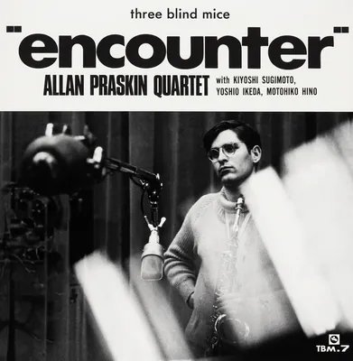

<!-- tbm-liner-cover:start -->

TBM-7<b>Encounter</b><small>Квартет Аллана Праскіна, 1971</small><a href="../Альбоми/TBM-7">Сторінка альбому →</a>

<!-- tbm-liner-cover:end -->

# ENCOUNTER (Зустріч)
## ALLAN PRASKIN (Алан Праскін)

**[[Артист — Алан Праскін|Алан Праскін]] (Allan Praskin)** (альт-саксофон), **[[Артист — Кійоші Сугімото|Кійоші Сугімото]] (Kiyoshi Sugimoto)** (гітара),
**[[Артист — Йошіо Ікеда|Йошіо Ікеда]] (Yoshio Ikeda)** (бас), **[[Артист — Мотохіко Хіно|Мотохіко Хіно]] (Motohiko Hino)** (ударні)

---

### СПИСОК КОМПОЗИЦІЙ

1. **Softly As In A Morning Sunrise** (朝日の如くさわやかに) (Romberg - Hammerstein) ... 11'39"
2. **The Height of Spring** (ザ・ハイト・オブ・スプリング) (Allan Praskin) .................. 10'35"
3. **Encounter** (エンカウンター) (Allan Praskin) ..................................................... 6'53"
4. **Reflectors** (リフレクターズ) (Allan Praskin) ...................................................... 6'16"
5. **Blues Connotation** (ブルース・カノテイション) (Ornette Coleman) ......................... 8'21"

---

**Запис:** 6 травня 1971 року, Aoi Studio, Токіо
**Звукорежисер (Recording Engineer):** Йошіхіко Каннарі (Yoshihiko Kannari) (Aoi)
**Асистент звукорежисера:** Кенджі Курода (Kenji Kuroda) (Aoi)
**Цифровий мастеринг:** 14 вересня 2000 року, JVC Mastering Center
**Інженер мастерингу:** Тору Котецу (Tohru Kotetsu) (JVC)
**Арт-директор:** Бен Нішізава (Ben Nishizawa)
**Співпраця:** Йошія Уодзумі (Yoshiya Uozumi), Кадзуміцу Сага (Kazumitsu Saga), Акінорі Фукутомі (Akinori Fukutomi)
**Анотації до альбому (Liner Notes):** Такесі Фудзії (Takeshi Fujii)

**Продюсер:** Такесі Фудзії (TBM)

---

## 《Анотації》 
**Такесі Фудзії (Takeshi Fujii)**

**1. Передісторія запису цього альбому...**

Це перший лідерський альбом 22-річного білого альт-саксофоніста Алана Праскіна. Моя перша зустріч з ним відбулася, коли я працював над створенням альбому [[Артист — Хідето Канаї|Хідето Канаї]] (Hideto Kanai) «Q» ([[TBM-6]]) — проектом, запланованим ще з минулої осені. Тоді [[Артист — Хідето Канаї|Хідето Канаї]] сказав мені: «Є один молодий альт-саксофоніст на ім'я [[Артист — Алан Праскін|Алан Праскін]], який зараз проходить військову службу в Південній Кореї, але він приїхав до Токіо у двотижневу відпустку, і я б дуже хотів, щоб ти з ним познайомився».

Канаї та Алан були давніми знайомими. Вони зустрілися в Лос-Анджелесі кілька років тому, коли Канаї приїхав до США зі своїм повним оркестром (full band) «Kings Roar» для виступу на концерті Мін-Он (Min-On).

Того вечора (27 квітня) ми зустрілися в клубі «Pit Inn» у Сіндзюку. Я представив Алана квінтету Терумаси Хіно (Terumasa Hino Quintet), і він отримав можливість зіграти з ними.

Шанувальники, які були присутні того вечора в «Pit Inn», безсумнівно пам'ятають, як [[Артист — Алан Праскін|Алан Праскін]] приєднався до квінтету Терумаси Хіно на композиції «My Funny Valentine» і розгорнув вражаючу гру. Загалом, цей хлопець на ім'я [[Артист — Алан Праскін|Алан Праскін]] — людина, яка зовсім не дбає про свій зовнішній вигляд, і на перший погляд здається досить непримітною. Як ви можете бачити на фотографії на обкладинці, волосся в нього розпатлане, він носить окуляри в тонкій оправі, його штани виглядають так, ніби їх не прасували щонайменше півмісяця, вони тримаються на пошарпаній краватці, і, до всього іншого, сорочка стирчить з-під светра. Крім того, він вийшов на сцену, тримаючи в руках позичений альт-саксофон, з такою невпевненістю і сором'язливістю, яку тільки можна уявити. Можливо, більшість шанувальників навіть уві сні не могли уявити, що він володіє такою силою. Проте, як тільки він почав грати, він розгорнув настільки дивовижне виконання, що всі були вражені: звідки в ньому приховано стільки життєвої енергії? Справді, це відчувалося як «виверження».

На моє запитання про те, що він думає про свою нинішню військову службу, він відповів лише одним словом: «Ненавиджу». Мабуть, саме розчарування (frustration) від поточної ситуації, коли йому довелося зробити абсолютно небажаний вибір, і від суворих умов військової служби, де він не мав жодної можливості грати джаз, стало рушійною силою того вибухового соло.

Окрім того вечора з квінтетом Терумаси Хіно, він також долучався і грав з квінтетом [[Артист — Масабумі Кікучі|Масабумі Кікучі]] (Masabumi Kikuchi Quintet), квінтетом Джорджа Оцуки (George Otsuka Quintet), тріо Йосуке Ямашіти (Yosuke Yamashita Trio) та іншими. Як він сам розповідав, можливість так вільно грати джаз була для нього найбільшою радістю з моменту призову на військову службу. Ввечері 1 травня, після того як [[Артист — Алан Праскін|Алан Праскін]] зіграв разом з квінтетом [[Артист — Масабумі Кікучі|Масабумі Кікучі]] в клубі «Junk», він залишився ночувати у мене вдома. Наступного дня вдень, після того як я показав йому храм Кенчо-дзі в Кіта-Камакурі та інші місця, і перед тим як ми попрощалися, я прийняв рішення записати його альбом.
Я запитав Алана: «Якщо наступного разу, коли ти матимеш відпустку і приїдеш до Токіо, у тебе буде можливість, я б хотів записати твій альбом. Чи міг би ти до того часу підготувати якісь ідеї?»
Він відповів: «Я був би дуже радий, але коли мене демобілізують у листопаді, я, мабуть, повернуся до Америки військовим літаком, і я не думаю, що до того часу зможу отримати ще одну відпустку». 
Але я за будь-яку ціну хотів записати Алана Праскіна саме в той момент, тому доклав усіх зусиль, щоб організувати цей запис.

Для ритм-секції він обрав трьох музикантів з квінтету Терумаси Хіно, з якими грав до того. До дня запису 6 травня він написав 3 композиції, що увійшли до цього альбому. І він вирішив назвати цей альбом «Encounter» (Зустріч) у прямому сенсі цього слова.

Цей альбом був створений за таких обставин. Через фізично несприятливі умови (брак часу) ми не змогли провести достатньо обговорень і репетицій. Тому, навіть якщо ці четверо музикантів не змогли зіграти тут найкращим чином (best play), вся відповідальність за це лежить на мені, адже саме я наполіг на створенні цього альбому. Незважаючи на це, я переконаний, що [[Артист — Алан Праскін|Алан Праскін]] демонструє тут принаймні проблиски своїх здібностей, навіть якщо це не можна назвати його найкращою роботою.

**2. Людина на ім'я [[Артист — Алан Праскін|Алан Праскін]]...**

[[Артист — Алан Праскін|Алан Праскін]] народився 17 грудня 1948 року в Лос-Анджелесі, штат Каліфорнія. Того року йому було 22. Близько 10 років він зацікавився джазом і, здається, на той час із задоволенням слухав альт-саксофоніста Джонні Ходжеса (Johnny Hodges). Він почав вчитися грати на саксофоні в 11 років, а його першою роботою став виступ у клубі «Lighthouse» на Гермоса-Біч (Hermosa Beach) влітку, коли йому було 15. Після цього на Західному узбережжі він приєднався до груп Джорджа Морроу (George Morrow), Боббі Гатчерсона (Bobby Hutcherson), Шеллі Менна (Shelly Manne) та інших, а також створив дволідерське тріо (two-headed trio) з геніальним басистом Альбертом Стінсоном (Albert Stinson). За цей час він недовго грав у Нью-Йорку з Джимом Зітро (Jim Zitro) та Аланом Сільвою (Alan Silva), а в складі секстету Джима Зітро він зробив запис на ESP-Disk. Це було 13 квітня 1967 року, коли йому було 18, і це його єдиний запис (ESP-1052). Окрім цього, в Лос-Анджелесі він також виступав із кількома рок-гуртами.

Те, що його зараз цікавить, — це вивчення різних культур і філософій з усього світу — особливо різних видів музики — а також письменництво; він уже публікував статті про музику в кількох журналах і газетах.

Коли ми говоримо про американців, зазвичай спадають на думку такі прикметники, як «веселий», але [[Артист — Алан Праскін|Алан Праскін]] — людина абсолютно мовчазна і непривітна. Коли я знайомив його з Пу-саном ([[Артист — Масабумі Кікучі|Масабумі Кікучі]]), я сказав: «Він добре знає себе, у нього багатий внутрішній світ, і він один із моїх улюблених джазменів у всьому світі, але він такий мовчазний». На що Алан коротко відповів: «Але ж я достатньо говорю через своє піаніно, чи не так?» — і вразив мене цією відповіддю.

Найближчим до музичного напрямку Алана Праскіна є концепція квінтету Терумаси Хіно — грати «в акордах» (in chord), але настільки вільно, наскільки це можливо. Проте здається, що він також був глибоко вражений музикою [[Артист — Масабумі Кікучі|Масабумі Кікучі]]. Я не знаю, чи однією з причин цього було те, що вони обидва мовчазні, непривітні і не дбають про свій зовнішній вигляд, але, як би там не було, він приєднувався до квінтету [[Артист — Масабумі Кікучі|Масабумі Кікучі]] близько трьох разів. 
У будь-якому разі, Алана Праскіна можна назвати видатним новим альт-саксофоністом великого масштабу, чия музична діяльність після звільнення з армії викликає великі сподівання.
